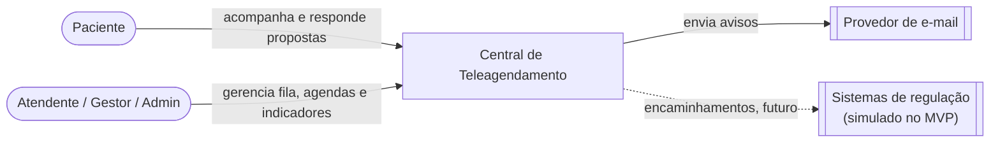

# SDD — Software Design Document

| | |
| --- | --- |
| **Versão** | 0.1 — outubro/2026 |
| **Escopo** | Backend, banco, Worker e implantação do MVP. O frontend será detalhado quando a tecnologia for definida ([ADR-001](../decisions/ADR-001-stack.md)) |
| **Documentos relacionados** | [PRD](../product/PRD.md) · [requisitos](../requirements/functional-requirements.md) · [modelo de dados](data-model.md) · [API](api-design.md) · [segurança](../security/security-overview.md) |

## 1. Visão geral

O sistema é **um único pacote Python executado em dois processos**:

- a **API** (FastAPI síncrono), que atende o frontend;
- o **Worker**, que executa os jobs agendados.

Os dois compartilham o mesmo código de domínio e o mesmo PostgreSQL, que é a única fonte de verdade. O Nginx é o único ponto de entrada externo.

### Contexto (C4 nível 1)



### Containers (C4 nível 2)


| Container | Responsabilidade | Não faz |
| --- | --- | --- |
| Nginx | TLS, arquivos estáticos do frontend, proxy de `/api/v1` | Lógica de negócio |
| API | Autenticação, autorização, cadastros, fila, transições de solicitação e agendamento, leituras e indicadores | Jobs agendados, envio de e-mail |
| Worker | Expiração de propostas, consumo da outbox, envio e retentativa de avisos, matching automático ([ADR-021](../decisions/ADR-021-matching-automatico.md)) | Atender HTTP |
| PostgreSQL | Todo o estado, inclusive a ocupação das vagas (derivada) e a outbox | — |

## 2. Organização do código

O backend fica em `apps/backend`, ao lado de `apps/web` e de `apps/mobile` (fase 2). É um único pacote Python:

```
apps/backend/app/
├── api/            # rotas, dependências (sessão, usuário, escopo), schemas Pydantic de entrada e saída
├── dominio/        # entidades, regras e serviços de aplicação — sem FastAPI nem SQLAlchemy
│   ├── contas/         # usuário, paciente, consentimento
│   ├── cadastros/      # unidade, especialidade, oferta, agenda, vaga
│   ├── fila/           # solicitação, regras de prioridade, ordenação
│   ├── agendamento/    # proposta, confirmação, cancelamento, expiração
│   ├── notificacoes/   # eventos, montagem dos avisos, interface CanalNotificacao
│   ├── indicadores/    # consultas do painel
│   └── auditoria/
├── infra/          # SQLAlchemy (modelos e repositórios), SMTP, ReguladorGateway simulado, relógio
└── worker/         # laço de jobs e agendamento das execuções
```

**Regra de dependência:** `api` e `worker` dependem de `dominio`; `dominio` depende só de interfaces que ele mesmo declara; `infra` implementa essas interfaces. As interfaces do domínio (inclusive `Relogio`, em `app/dominio/relogio.py`) ficam em `app/dominio`, e as implementações (`RelogioReal`, `RelogioFixo`, repositórios, SMTP) em `app/infra`. Nenhum módulo de `app/dominio` importa de `app/infra`. Assim as regras de negócio são testadas sem banco nem HTTP (RNF-042).

Os subpacotes de `dominio` seguem as frentes verticais da equipe ([CONTRIBUTING](../../CONTRIBUTING.md)).

### Por que API e Worker ficam no mesmo pacote

Os dois executam as mesmas regras: confirmar uma proposta (API) e expirar uma proposta (Worker) usam a mesma entidade `Agendamento`. Com pastas separadas, seria preciso duplicar o domínio ou criar um terceiro pacote compartilhado, com dependências entre eles. No mesmo pacote, a separação acontece só na execução: uma imagem Docker, dois comandos.

```yaml
# docker-compose.yml (trecho ilustrativo)
services:
  api:
    build: ./apps/backend
    command: uvicorn app.api.main:app --host 0.0.0.0 --port 8000
  worker:
    build: ./apps/backend          # mesma imagem
    command: python -m app.worker  # outro ponto de entrada
```

| | API | Worker |
| --- | --- | --- |
| Quando executa | Quando chega uma requisição | Sozinho, em intervalos regulares |
| Quem dispara | Paciente ou equipe, pelo frontend | O relógio |
| Exemplos | Confirmar presença, abrir a fila, ver indicadores | Expirar proposta vencida, enviar e-mail, retentar envio que falhou |
| Expectativa de tempo | Responder rápido, com alguém esperando na tela | Pode demorar e repetir sem ninguém esperando |
| Instâncias | Vários processos do Uvicorn | Um, ou mais com `SKIP LOCKED` |

API e Worker não chamam um ao outro: a API grava o estado e um evento na `outbox`, e o Worker lê esse evento do banco ([ADR-005](../decisions/ADR-005-worker-separado.md), [ADR-006](../decisions/ADR-006-outbox.md)).

Se o projeto crescer a ponto de API e Worker precisarem de ciclos de versão independentes, o caminho é extrair `dominio` e `infra` para um pacote compartilhado (por exemplo, `packages/core`), com um novo ADR.

## 3. Interfaces internas

| Interface | Para que serve | Implementações |
| --- | --- | --- |
| `CanalNotificacao` | Entregar uma mensagem por um canal externo (`enviar(Mensagem)`; falha = exceção) | `CanalEmailSmtp` (`infra/email.py`); depois Telegram e push ([ADR-010](../decisions/ADR-010-integracoes-por-interface.md)). O aviso no site não passa pela interface: é a própria linha de `notificacao` com canal `IN_APP` |
| `ReguladorGateway` | Obter encaminhamentos e a classificação de risco | Simulada com dados sintéticos |
| `Relogio` | Fornecer "agora" com fuso | Real; fixo nos testes ([ADR-008](../decisions/ADR-008-datas-e-fuso.md)) |
| Repositórios | Persistir e consultar agregados | SQLAlchemy |
| `UnidadeDeTrabalho` | Delimitar a transação que grava estado, auditoria e outbox juntos | Sessão SQLAlchemy |

## 4. Dados

O esquema, as restrições e os índices estão no [modelo de dados](data-model.md). Três decisões estruturam o design:

1. **Solicitação separada de agendamento:** a fila é feita de solicitações; cada proposta é um agendamento novo.
2. **Ocupação derivada:** um índice único parcial impede dois agendamentos ativos na mesma vaga ([ADR-004](../decisions/ADR-004-ocupacao-da-vaga.md)).
3. **Outbox na mesma transação:** nenhum aviso é perdido ou enviado sobre algo não gravado ([ADR-006](../decisions/ADR-006-outbox.md)).
4. **Fila como entidade, com protocolo próprio:** cada fila tem elegibilidade, prazos e critérios com peso; a posição é calculada na consulta, nunca gravada ([ADR-024](../decisions/ADR-024-protocolo-por-fila.md), [ADR-027](../decisions/ADR-027-fila-como-entidade.md)).

## 5. Fluxos técnicos

### 5.1 Transição de estado (padrão para todas)

Toda transição de solicitação ou agendamento segue o mesmo roteiro, dentro de uma única transação:

1. Carregar o agregado com `SELECT ... FOR UPDATE`.
2. Verificar dono (paciente) ou permissão e escopo (equipe).
3. Verificar o estado de origem e o prazo com o `Relogio`.
4. Aplicar a transição.
5. Gravar a auditoria.
6. Gravar o evento na outbox.
7. Fazer o commit.

Se o estado de origem não for o esperado, a resposta é `409`. Isso cobre cliques duplicados e corridas com o Worker.

### 5.2 Proposta → aviso

Ver [UC-003](../requirements/use-cases/UC-003-propor-vaga.md) e o [diagrama de atividades da fila](diagrams/activity-queue.md). A proposta grava o agendamento e o evento; o Worker consome o evento, cria os avisos e envia o e-mail.

**Avisos (RF-018, RF-019, RF-024).** O mapeamento evento → aviso e os textos ficam em `dominio/notificacoes/` (`montar_avisos()`, `textos.py`).

- `processar_outbox` cria, por evento, o aviso no site (nasce `ENVIADA`) e, se o tipo prevê e o paciente tem e-mail cadastrado, um aviso `EMAIL` `PENDENTE`. O mesmo evento processado duas vezes não duplica (`uq_notificacao_outbox_usuario_canal`). Tipo de evento sem texto definido falha em teste na CI.
- `enviar_emails` envia os `PENDENTE` vencidos pelo `CanalNotificacao`. Falha agenda nova tentativa em 1, 5, 15 e 60 min; ao chegar em `OUTBOX_MAX_TENTATIVAS`, o aviso fica `FALHOU`. Entrega "pelo menos uma vez": se o Worker cair entre o envio e o commit, o e-mail sai de novo.
- O evento sobre a solicitação leva `fim_da_fila` no payload, para o aviso dizer o efeito da transição e não o estado de quando for lido.
- E-mail (AM-008, AM-015): assunto fixo, só prazo ou data e hora, e o link `APP_URL_PUBLICA`. Falta, cancelamento e prazo expirado (`FALTA_REGISTRADA`, `AGENDAMENTO_CANCELADO`, `SOLICITACAO_CANCELADA`, `PROPOSTA_EXPIRADA`) usam texto neutro: "Há uma atualização no seu atendimento. Para ver os detalhes, entre na Central." Nenhum e-mail revela falta, cancelamento nem o retorno ao fim da fila; o detalhe fica só no aviso do site.
- Tipos que vão por e-mail: `PROPOSTA_ENVIADA`, `AGENDAMENTO_CONFIRMADO`, `PROPOSTA_EXPIRADA`, `AGENDAMENTO_CANCELADO`, `SOLICITACAO_CANCELADA`, `FALTA_REGISTRADA` e `LEMBRETE`. Os demais (`SOLICITACAO_CRIADA`, `SOLICITACAO_NA_FILA`, `PROPOSTA_RECUSADA`, `ATENDIMENTO_REGISTRADO`) só no site.
- Para os eventos, o e-mail sai para quem tem e-mail cadastrado (finalidade `AGENDAMENTO`); o lembrete exige também o consentimento `LEMBRETE_EMAIL` vigente (RN-009), conferido de novo no envio.

### 5.3 Confirmação

Ver [UC-004](../requirements/use-cases/UC-004-confirmar-proposta.md) e o [diagrama de sequência](diagrams/sequence-confirmation.md). O prazo é verificado na própria confirmação, sem depender de o Worker já ter expirado a proposta.

### 5.4 Cancelamento e liberação da vaga

Ver [UC-005](../requirements/use-cases/UC-005-pedir-outra-data-ou-cancelar.md) e o [diagrama de sequência](diagrams/sequence-cancellation.md). Cancelar ou recusar só muda o status do agendamento; a vaga fica livre porque deixa de ter agendamento ativo ([ADR-004](../decisions/ADR-004-ocupacao-da-vaga.md)), e o job `propor_vagas` a oferece ao próximo da fila na rodada seguinte, se ainda couber a janela mínima (RN-016).

### 5.4a Presença

Ver [UC-008](../requirements/use-cases/UC-008-registrar-comparecimento-ou-falta.md). A equipe consulta a agenda do dia e registra comparecimento (a partir do início da vaga) ou falta (depois da tolerância, `pode_marcar_falta()`); a regra fica em `registrar_presenca()` no domínio.

### 5.5 Jobs do Worker

| Job | Frequência *(proposta)* | Seleção | Garantia |
| --- | --- | --- | --- |
| Gerar vagas (`gerar_vagas`) | `WORKER_INTERVALO_VAGAS_S` (padrão 3600 s) | Agendas ativas de filas ativas; vagas dos próximos `VAGAS_HORIZONTE_DIAS` dias (padrão 30), em hora local de Recife, gravadas em `timestamptz` | Idempotente: `ON CONFLICT (agenda_id, inicio) DO NOTHING`; agenda travada com `SKIP LOCKED` |
| Matching automático (`propor_vagas`) | `WORKER_INTERVALO_MATCHING_S` (padrão 60 s); só com `MATCHING_AUTOMATICO=true` ([ADR-021](../decisions/ADR-021-matching-automatico.md)) | Vagas `ATIVA`, futuras, sem agendamento ativo, de filas com alguém `NA_FILA`, em ordem de início. Escolha por `propor_vaga()` entre as primeiras 50 compatíveis | Vaga e solicitação escolhida com `SKIP LOCKED`; índices únicos decidem a corrida; conflito descarta só aquela vaga |
| Expirar propostas (`expirar_propostas`) | `WORKER_INTERVALO_EXPIRACAO_S` | `PROPOSTO` com `expira_em <= agora`; a solicitação volta ao fim da fila ([ADR-026](../decisions/ADR-026-prazos-e-volta-ao-fim-da-fila.md)) | Idempotente; `SKIP LOCKED` |
| Processar outbox (`processar_outbox`) | `WORKER_INTERVALO_OUTBOX_S` (padrão 10 s) | `PENDENTE` com `tentativas = 0` (evento novo) ou `proximo_retry_em <= agora` (nova tentativa); cria os avisos do evento | Pelo menos uma vez; `SKIP LOCKED`; `uq_notificacao_outbox_usuario_canal` impede aviso duplicado. Falha agenda nova tentativa; no limite o evento fica `FALHOU` |
| Enviar e-mails (`enviar_emails`) | `WORKER_INTERVALO_EMAIL_S` (padrão 15 s) | Avisos `EMAIL` `PENDENTE` com `proximo_retry_em <= agora` | Pelo menos uma vez; `SKIP LOCKED`; recuo de 1, 5, 15 e 60 min; `SMTP_TIMEOUT_S` evita travar o Worker. Absorve a antiga "retentativa de avisos": não há job separado |
| Enviar lembretes (`enviar_lembretes`) | `WORKER_INTERVALO_LEMBRETE_S` (padrão 3600 s) | Agendamentos `CONFIRMADO` com início entre agora e agora + `LEMBRETE_ANTECEDENCIA_HORAS` (padrão 24) e sem lembrete | Um lembrete por agendamento e canal (`ux_notificacao_lembrete`); trava de leitura (`FOR SHARE SKIP LOCKED`) em solicitação e depois agendamento. O `enviar_emails` cancela o e-mail (`CANCELADA`) se o agendamento deixou de estar confirmado ou o consentimento foi revogado |

**Lote por rodada.** Cada job que busca itens pendentes (`propor_vagas`, `expirar_propostas`, `processar_outbox`, `enviar_emails`, `enviar_lembretes`) processa no máximo `WORKER_LOTE_MAXIMO` itens por rodada (padrão 100, mínimo 1); o resto fica para a próxima. `gerar_vagas` e a limpeza de retenção não são limitados.

**Por que o lembrete roda de hora em hora.** A proposta só é feita com antecedência mínima de 24 h antes da vaga (RN-008) e o lembrete sai para consultas que começam nas próximas `LEMBRETE_ANTECEDENCIA_HORAS` (24 h). A janela é de horas, então uma varredura horária basta; um intervalo menor só geraria consultas vazias ao banco.

Cada item (agenda, vaga, proposta, evento ou aviso) roda na própria transação: um item com erro não derruba o lote, e o log leva só IDs e o tipo do erro. A ordem das travas é a mesma em todos os caminhos: vaga (só o matching), solicitação, agendamento.

### 5.6 Pontos únicos de troca

Cada regra de negócio que a UPE pode ajustar fica num único lugar do código, para a mudança não se espalhar.

| Ponto | Flag | Decisão |
| --- | --- | --- |
| `propor_vaga(candidatas, vaga, agora, ...)` em `dominio/agendamento/proposta.py`: escolhe a primeira apta na ordem da fila (turno RN-019, nunca a mesma vaga duas vezes) e devolve proposta, evento e `expira_em` | `MATCHING_AUTOMATICO` | [ADR-021](../decisions/ADR-021-matching-automatico.md) |
| `calcular_expira_em()` em `dominio/agendamento/prazos.py` | `PROPOSTA_ANTECEDENCIA_MINIMA_HORAS`, `PROPOSTA_JANELA_MINIMA_HORAS` | [ADR-021](../decisions/ADR-021-matching-automatico.md), [ADR-026](../decisions/ADR-026-prazos-e-volta-ao-fim-da-fila.md) |
| `ordenar_fila(solicitacoes)` em `dominio/fila/ordenacao.py`; `calcular_pontos()` e `calcular_nota()` em `dominio/fila/criterios.py` | — (protocolo em `criterio_fila`) | [ADR-024](../decisions/ADR-024-protocolo-por-fila.md) |
| `calcular_escopo()` em `dominio/acesso.py`, exposto pela dependência `escopo_da_equipe()` | — (atribuições em `usuario_fila` e `usuario_unidade`) | [ADR-025](../decisions/ADR-025-escopo-por-fila.md) |
| `pode_marcar_falta()` e `reentrar_no_fim_da_fila()`; `registrar_presenca()` em `dominio/agendamento/estados.py` | — (prazo e tolerância na `fila`) | [ADR-026](../decisions/ADR-026-prazos-e-volta-ao-fim-da-fila.md) |
| `recusar_proposta()` em `dominio/solicitacao.py` (contagem em `contar_recusas()`, desde a última entrada na fila) | `RECUSAS_MANTENDO_POSICAO` | RN-020 *(proposta)* |
| `situacao_da_vaga()` em `dominio/agendamento/vagas.py` | — | RN-016, [ADR-021](../decisions/ADR-021-matching-automatico.md) |
| `verificar_elegibilidade()` em `dominio/fila/elegibilidade.py` | — (elegibilidade na `fila`) | [ADR-027](../decisions/ADR-027-fila-como-entidade.md) |
| `pode_autenticar()` em `dominio/acesso.py` | — (`usuario.situacao`) | [ADR-028](../decisions/ADR-028-suspensao-de-acesso.md) |

## 6. Concorrência

| Situação | Mecanismo |
| --- | --- |
| Duas propostas para a mesma vaga | Índice único parcial; o perdedor recebe violação de unicidade → `409` ou descarte |
| Paciente confirma enquanto o Worker expira | `FOR UPDATE` no agendamento; quem pega o lock depois encontra outro estado e não altera |
| Dois Workers no mesmo lote | `FOR UPDATE SKIP LOCKED` |
| Paciente cancela enquanto o Worker expira | Os dois travam solicitação e depois agendamento; o Worker usa `SKIP LOCKED` e pula |
| Dois Workers no matching | Vaga e solicitação escolhida com `SKIP LOCKED`; se a escolhida estiver travada, passa para a próxima da ordem |
| Clique duplo em "Confirmar" | A segunda chamada encontra `CONFIRMADO` → `409`, sem novo evento |

## 7. Erros

- Respostas de erro em *Problem Details* (RFC 9457), com `type` estável para o frontend tratar cada caso.
- Violações de unicidade conhecidas (vaga ocupada, proposta ativa) são traduzidas para `409`; qualquer outra vira `500`. O erro inesperado é tratado por um middleware que registra só o tipo da exceção e o SQLSTATE, nunca a mensagem nem o traceback, porque a mensagem do Postgres pode repetir valores (ex.: `Key (cpf)=...`). Não é um `exception_handler(Exception)`: esse handler roda no `ServerErrorMiddleware` do Starlette, que relança a exceção para o servidor logar com a mensagem. Erros HTTP e de domínio (`404`, `409`...) não passam por esse middleware.
- Recurso de outro paciente responde `404`, nunca `403`, para não revelar que existe.

## 8. Configuração

Toda configuração vem de variáveis de ambiente (nomes definitivos no `.env.example` do setup):

- conexão com o banco;
- chaves e duração dos tokens;
- domínio do cookie;
- SMTP (`SMTP_*`, inclusive `SMTP_TIMEOUT_S`) e o endereço oficial da Central nos e-mails (`APP_URL_PUBLICA`; em produção precisa ser `https://` e público);
- intervalo dos jobs e `WORKER_LOTE_MAXIMO`;
- limite de retentativas;
- `LEMBRETE_ANTECEDENCIA_HORAS` (RF-024);
- antecedência mínima para propor (RN-008) e janela mínima para o paciente responder (RN-016).

Prazo de confirmação, tolerância de atraso, elegibilidade e critérios de prioridade não são variáveis de ambiente: ficam nos dados de cada fila ([ADR-027](../decisions/ADR-027-fila-como-entidade.md)).

## 9. Estratégia de testes

| Nível | Cobre | Como |
| --- | --- | --- |
| Unidade | Regras de `dominio` (transições, ordenação da fila, prazos) | Sem banco; `Relogio` fixo; implementações falsas das interfaces |
| Integração | Repositórios, restrições do banco, migração, seed, rotas da API | PostgreSQL real do Docker Compose, num banco separado `<POSTGRES_DB>_test`, recriado e migrado a cada execução; cada teste roda numa transação desfeita no fim |
| Concorrência | RN-001, RN-002, confirmação × expiração | Duas sessões em threads disputando o mesmo registro |
| Segurança | Dono do recurso, papéis, CSRF | Um teste de acesso negado por rota com ID |
| Contrato | Esquema OpenAPI | Gerado pelo FastAPI e verificado na CI |

Os critérios de aceite dos [casos de uso](../requirements/use-cases/README.md) são a lista mínima de testes de integração.

## 10. Implantação

Ver [implantação](../operations/deployment.md) e o [diagrama de implantação](diagrams/deployment.md).

## 11. Decisões e pendências

- Decisões: [ADRs](../decisions/README.md).
- As questões ABERTO-1 a 4 foram respondidas pela UPE em 15/10/2026: [ADR-021](../decisions/ADR-021-matching-automatico.md) e [ADR-024](../decisions/ADR-024-protocolo-por-fila.md) a [ADR-028](../decisions/ADR-028-suspensao-de-acesso.md). Os pontos de troca estão na seção 5.6.
- Propostas para depois: [ADR-029](../decisions/ADR-029-overbooking-por-vagas-extras.md) (overbooking) e [ADR-030](../decisions/ADR-030-historico-familiar-como-criterio.md) (histórico familiar).
- Não há questões em aberto ([histórico](../requirements/open-questions.md)).
