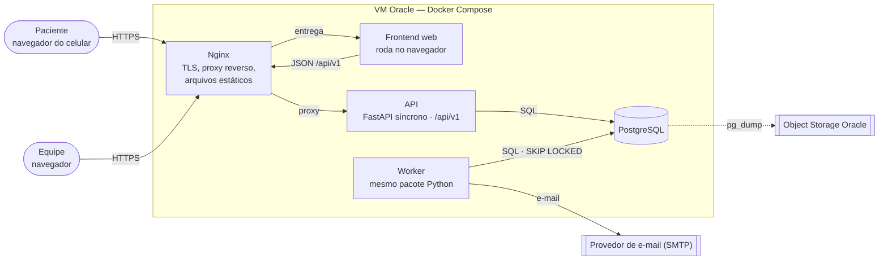

# SDD — Software Design Document

| | |
| --- | --- |
| **Versão** | 0.1 — outubro/2026 |
| **Escopo** | Backend, banco, Worker e implantação do MVP. O frontend será detalhado quando a tecnologia for definida ([ADR-001](../decisions/ADR-001-stack.md)) |
| **Documentos relacionados** | [PRD](../product/PRD.md) · [requisitos](../requirements/functional-requirements.md) · [modelo de dados](data-model.md) · [API](api-design.md) · [segurança](../security/security-overview.md) |

## 1. Visão geral

O sistema é **um único pacote Python executado em dois processos**:

- a **API** (FastAPI síncrono), que atende o frontend;
- o **Worker**, que executa os jobs agendados.

Os dois compartilham o mesmo código de domínio e o mesmo PostgreSQL, que é a única fonte de verdade. O Nginx é o único ponto de entrada externo.

### Contexto (C4 nível 1)


### Containers (C4 nível 2)



| Container | Responsabilidade | Não faz |
| --- | --- | --- |
| Nginx | TLS, arquivos estáticos do frontend, proxy de `/api/v1` | Lógica de negócio |
| API | Autenticação, autorização, cadastros, fila, transições de solicitação e agendamento, leituras e indicadores | Jobs agendados, envio de e-mail |
| Worker | Expiração de propostas, consumo da outbox, envio e retentativa de avisos, matching automático ([ADR-021](../decisions/ADR-021-matching-automatico.md)) | Atender HTTP |
| PostgreSQL | Todo o estado, inclusive a ocupação das vagas (derivada) e a outbox | — |

## 2. Organização do código

O backend fica em `apps/backend`, ao lado de `apps/web` e de `apps/mobile` (fase 2). É um único pacote Python:

```
apps/backend/app/
├── api/            # rotas, dependências (sessão, usuário, escopo), schemas Pydantic de entrada e saída
├── dominio/        # entidades, regras e serviços de aplicação — sem FastAPI nem SQLAlchemy
│   ├── contas/         # usuário, paciente, consentimento
│   ├── cadastros/      # unidade, especialidade, oferta, agenda, vaga
│   ├── fila/           # solicitação, regras de prioridade, ordenação
│   ├── agendamento/    # proposta, confirmação, cancelamento, expiração
│   ├── notificacoes/   # eventos, montagem dos avisos, interface CanalNotificacao
│   ├── indicadores/    # consultas do painel
│   └── auditoria/
├── infra/          # SQLAlchemy (modelos e repositórios), SMTP, ReguladorGateway simulado, relógio
└── worker/         # laço de jobs e agendamento das execuções
```

**Regra de dependência:** `api` e `worker` dependem de `dominio`; `dominio` depende só de interfaces que ele mesmo declara; `infra` implementa essas interfaces. Assim as regras de negócio são testadas sem banco nem HTTP (RNF-042).

Os subpacotes de `dominio` seguem as frentes verticais da equipe ([CONTRIBUTING](../../CONTRIBUTING.md)).

### Por que API e Worker ficam no mesmo pacote

Os dois executam as mesmas regras: confirmar uma proposta (API) e expirar uma proposta (Worker) usam a mesma entidade `Agendamento`. Com pastas separadas, seria preciso duplicar o domínio ou criar um terceiro pacote compartilhado, com dependências entre eles. No mesmo pacote, a separação acontece só na execução: uma imagem Docker, dois comandos.

```yaml
# docker-compose.yml (trecho ilustrativo)
services:
  api:
    build: ./apps/backend
    command: uvicorn app.api.main:app --host 0.0.0.0 --port 8000
  worker:
    build: ./apps/backend          # mesma imagem
    command: python -m app.worker  # outro ponto de entrada
```

| | API | Worker |
| --- | --- | --- |
| Quando executa | Quando chega uma requisição | Sozinho, em intervalos regulares |
| Quem dispara | Paciente ou equipe, pelo frontend | O relógio |
| Exemplos | Confirmar presença, abrir a fila, ver indicadores | Expirar proposta vencida, enviar e-mail, retentar envio que falhou |
| Expectativa de tempo | Responder rápido, com alguém esperando na tela | Pode demorar e repetir sem ninguém esperando |
| Instâncias | Vários processos do Uvicorn | Um, ou mais com `SKIP LOCKED` |

API e Worker não chamam um ao outro: a API grava o estado e um evento na `outbox`, e o Worker lê esse evento do banco ([ADR-005](../decisions/ADR-005-worker-separado.md), [ADR-006](../decisions/ADR-006-outbox.md)).

Se o projeto crescer a ponto de API e Worker precisarem de ciclos de versão independentes, o caminho é extrair `dominio` e `infra` para um pacote compartilhado (por exemplo, `packages/core`), com um novo ADR.

## 3. Interfaces internas

| Interface | Para que serve | Implementações |
| --- | --- | --- |
| `CanalNotificacao` | Entregar um aviso por um canal | `InApp`, `Email` (SMTP); depois Telegram e push ([ADR-010](../decisions/ADR-010-integracoes-por-interface.md)) |
| `ReguladorGateway` | Obter encaminhamentos e a classificação de risco | Simulada com dados sintéticos |
| `Relogio` | Fornecer "agora" com fuso | Real; fixo nos testes ([ADR-008](../decisions/ADR-008-datas-e-fuso.md)) |
| Repositórios | Persistir e consultar agregados | SQLAlchemy |
| `UnidadeDeTrabalho` | Delimitar a transação que grava estado, auditoria e outbox juntos | Sessão SQLAlchemy |

## 4. Dados

O esquema, as restrições e os índices estão no [modelo de dados](data-model.md). Três decisões estruturam o design:

1. **Solicitação separada de agendamento:** a fila é feita de solicitações; cada proposta é um agendamento novo.
2. **Ocupação derivada:** um índice único parcial impede dois agendamentos ativos na mesma vaga ([ADR-004](../decisions/ADR-004-ocupacao-da-vaga.md)).
3. **Outbox na mesma transação:** nenhum aviso é perdido ou enviado sobre algo não gravado ([ADR-006](../decisions/ADR-006-outbox.md)).

## 5. Fluxos técnicos

### 5.1 Transição de estado (padrão para todas)

Toda transição de solicitação ou agendamento segue o mesmo roteiro, dentro de uma única transação:

1. Carregar o agregado com `SELECT ... FOR UPDATE`.
2. Verificar dono (paciente) ou permissão e escopo (equipe).
3. Verificar o estado de origem e o prazo com o `Relogio`.
4. Aplicar a transição.
5. Gravar a auditoria.
6. Gravar o evento na outbox.
7. Fazer o commit.

Se o estado de origem não for o esperado, a resposta é `409`. Isso cobre cliques duplicados e corridas com o Worker.

### 5.2 Proposta → aviso

Ver [UC-003](../requirements/use-cases/UC-003-propor-vaga.md) e o [diagrama de atividades da fila](diagrams/activity-queue.md). A proposta grava o agendamento e o evento; o Worker consome o evento, cria os avisos e envia o e-mail.

### 5.3 Confirmação

Ver [UC-004](../requirements/use-cases/UC-004-confirmar-proposta.md) e o [diagrama de sequência](diagrams/sequence-confirmation.md). O prazo é verificado na própria confirmação, sem depender de o Worker já ter expirado a proposta.

### 5.4 Cancelamento e liberação da vaga

Ver [UC-005](../requirements/use-cases/UC-005-pedir-outra-data-ou-cancelar.md) e o [diagrama de sequência](diagrams/sequence-cancellation.md).

### 5.5 Jobs do Worker

| Job | Frequência *(proposta)* | Seleção | Garantia |
| --- | --- | --- | --- |
| Expirar propostas | a cada 1 min | `PROPOSTO` com `expira_em < agora` | Idempotente; `SKIP LOCKED` |
| Processar outbox | a cada 10 s | `PENDENTE` com `proximo_retry_em <= agora` | Pelo menos uma vez; o consumo tolera evento repetido |
| Retentar avisos | junto com a outbox | `FALHOU` com tentativas abaixo do limite | Recuo progressivo entre tentativas |
| Matching automático | ao processar eventos de vaga livre | Ativo no MVP ([ADR-021](../decisions/ADR-021-matching-automatico.md)) | Índice único decide a corrida |

### 5.6 Pontos únicos de troca

Decisões provisórias do MVP ficam num único lugar do código, para a troca não se espalhar.

| Ponto | Flag | Decisão |
| --- | --- | --- |
| `propor_vaga(solicitacao, vaga, proposto_por)` | `MATCHING_AUTOMATICO` | [ADR-021](../decisions/ADR-021-matching-automatico.md) |
| `ordenar_fila(solicitacoes, regras)` em `dominio/fila` | — (CHECK de `regra_prioridade.criterio`) | [ADR-022](../decisions/ADR-022-ordem-da-fila-sem-aging.md) |
| `escopo_da_equipe()` | `ESCOPO_POR_UNIDADE` | [ADR-023](../decisions/ADR-023-escopo-todas-as-unidades.md) |

## 6. Concorrência

| Situação | Mecanismo |
| --- | --- |
| Duas propostas para a mesma vaga | Índice único parcial; o perdedor recebe violação de unicidade → `409` ou descarte |
| Paciente confirma enquanto o Worker expira | `FOR UPDATE` no agendamento; quem pega o lock depois encontra outro estado e não altera |
| Dois Workers no mesmo lote | `FOR UPDATE SKIP LOCKED` |
| Clique duplo em "Confirmar" | A segunda chamada encontra `CONFIRMADO` → `409`, sem novo evento |

## 7. Erros

- Respostas de erro em *Problem Details* (RFC 9457), com `type` estável para o frontend tratar cada caso.
- Violações de unicidade conhecidas (vaga ocupada, proposta ativa) são traduzidas para `409`; qualquer outra vira `500`, registrada nos logs sem dados pessoais.
- Recurso de outro paciente responde `404`, nunca `403`, para não revelar que existe.

## 8. Configuração

Toda configuração vem de variáveis de ambiente (nomes definitivos no `.env.example` do setup):

- conexão com o banco;
- chaves e duração dos tokens;
- domínio do cookie;
- SMTP;
- intervalo dos jobs;
- limite de retentativas;
- antecedência mínima para propor (RN-008).

## 9. Estratégia de testes

| Nível | Cobre | Como |
| --- | --- | --- |
| Unidade | Regras de `dominio` (transições, ordenação da fila, prazos) | Sem banco; `Relogio` fixo; implementações falsas das interfaces |
| Integração | Repositórios, restrições do banco, rotas da API | PostgreSQL real do Docker Compose, banco limpo por teste |
| Concorrência | RN-001, RN-002, confirmação × expiração | Duas sessões em threads disputando o mesmo registro |
| Segurança | Dono do recurso, papéis, CSRF | Um teste de acesso negado por rota com ID |
| Contrato | Esquema OpenAPI | Gerado pelo FastAPI e verificado na CI |

Os critérios de aceite dos [casos de uso](../requirements/use-cases/README.md) são a lista mínima de testes de integração.

## 10. Implantação

Ver [implantação](../operations/deployment.md) e o [diagrama de implantação](diagrams/deployment.md).

## 11. Decisões e pendências

- Decisões: [ADRs](../decisions/README.md).
- Provisórias: [ADR-021](../decisions/ADR-021-matching-automatico.md) (matching automático), [ADR-022](../decisions/ADR-022-ordem-da-fila-sem-aging.md) (ordem da fila sem aging) e [ADR-023](../decisions/ADR-023-escopo-todas-as-unidades.md) (equipe vê todas as unidades). Trocam pelos pontos da seção 5.6.
- Em aberto: **ABERTO-4** (efeito da falta). Ver [questões em aberto](../requirements/open-questions.md).
