# Modelo de dados

PostgreSQL. Identificadores `uuid` gerados pelo banco (`gen_random_uuid()`); datas e horas como `timestamptz` ([ADR-008](../decisions/ADR-008-datas-e-fuso.md)). A fonte de verdade são as migrações em `apps/backend/migrations/versions/` (`0002_esquema_do_dominio.py` e `0003_sessao_de_refresh_e_tentativas_de_login.py`); os modelos SQLAlchemy em `app/infra/modelos.py` a espelham, e um teste (`alembic check`) falha se os dois divergirem.

Convenções:

- valores fechados (status, papel, risco...) são `text` com `CHECK (coluna IN (...))`, não enum do Postgres;
- toda FK usa `ON DELETE RESTRICT`: nada é apagado em cascata;
- `auditoria` e `historico_solicitacao` são append-only, garantido por gatilho no banco.

```mermaid
erDiagram
  USUARIO ||--o| PACIENTE : "conta de"
  USUARIO ||--o{ AUDITORIA : "ator"
  USUARIO ||--o{ SESSAO_REFRESH : "ADR-003 sessoes"
  SESSAO_REFRESH |o--o| SESSAO_REFRESH : "substituido por"
  USUARIO ||--o{ NOTIFICACAO : "destinatario"
  USUARIO ||--o{ USUARIO_FILA : "ADR-025 atendente"
  FILA ||--o{ USUARIO_FILA : "ADR-025"
  USUARIO ||--o{ USUARIO_UNIDADE : "ADR-025 gestor"
  UNIDADE ||--o{ USUARIO_UNIDADE : "ADR-025"
  PACIENTE ||--o{ CONSENTIMENTO : "concede"
  PACIENTE ||--o{ SOLICITACAO : "faz"
  UNIDADE ||--o{ FILA : "oferece"
  ESPECIALIDADE ||--o{ FILA : "agrupa"
  FILA ||--o{ CRITERIO_FILA : "protocolo ADR-024"
  FILA ||--o{ AGENDA : "organiza"
  FILA ||--o{ SOLICITACAO : "contem"
  AGENDA ||--o{ VAGA : "gera"
  SOLICITACAO ||--o{ RESPOSTA_CRITERIO : "responde"
  CRITERIO_FILA ||--o{ RESPOSTA_CRITERIO : "respondido em"
  SOLICITACAO ||--o{ HISTORICO_SOLICITACAO : "linha do tempo"
  SOLICITACAO ||--o{ AGENDAMENTO : "recebe propostas"
  VAGA ||--o{ AGENDAMENTO : "ocupada por"
  USUARIO |o--o{ AGENDAMENTO : "propos; nulo = automatico"
  SOLICITACAO |o--o{ NOTIFICACAO : "sobre"
  AGENDAMENTO |o--o{ NOTIFICACAO : "sobre"

  USUARIO {
    uuid id PK
    text email UK "anulavel; opcional para paciente, unico quando informado"
    text senha_hash
    text papel "CHECK PACIENTE ATENDENTE GESTOR ADMIN"
    text situacao "CHECK ATIVO SUSPENSO; ADR-028"
    timestamptz suspenso_em "obrigatorio se SUSPENSO"
    text motivo_suspensao
    timestamptz criado_em
  }
  SESSAO_REFRESH {
    uuid id PK
    uuid usuario_id FK "indice"
    uuid familia_id "indice; uma por login"
    text token_hash UK "SHA-256 do refresh token"
    timestamptz criado_em
    timestamptz expira_em
    timestamptz revogado_em "nulo = ativo"
    uuid substituido_por_id FK "rotacao"
    timestamptz reapresentado_em "AM-003: uso unico da tolerancia"
    inet ip
  }
  TENTATIVA_LOGIN {
    uuid id PK
    text tipo "CHECK LOGIN REGISTRO"
    text identificador_hash "HMAC-SHA256; obrigatorio se LOGIN"
    inet ip
    bool sucesso
    timestamptz ocorrido_em
  }
  PACIENTE {
    uuid id PK
    uuid usuario_id FK, UK
    text nome
    text cpf UK "11 digitos; mascarado na interface"
    text cns UK "cartao do SUS; anulavel"
    date data_nascimento
    text telefone
    text sexo "CHECK FEMININO MASCULINO; anulavel; so elegibilidade"
    text municipio "anulavel; so direcionamento"
  }
  CONSENTIMENTO {
    uuid id PK
    uuid paciente_id FK
    text finalidade "CHECK AGENDAMENTO LEMBRETE_EMAIL"
    text versao_termo
    timestamptz concedido_em
    timestamptz revogado_em "nulo = vigente"
  }
  UNIDADE {
    uuid id PK
    text sigla UK
    text nome
    text endereco
  }
  ESPECIALIDADE {
    uuid id PK
    text nome UK
  }
  FILA {
    uuid id PK
    uuid unidade_id FK
    uuid especialidade_id FK
    text nome "UK junto com unidade_id"
    text descricao_paciente
    text sexo_elegivel "nulo = qualquer"
    smallint idade_minima "nulo = sem minimo"
    smallint idade_maxima "nulo = sem maximo"
    int prazo_confirmacao_horas "padrao 48; ADR-026"
    int tolerancia_atraso_min "padrao 60; ADR-026"
    bool ativa
  }
  CRITERIO_FILA {
    uuid id PK
    uuid fila_id FK
    text codigo "UK junto com fila_id"
    text descricao
    text tipo "CHECK SIM_NAO NUMERO OPCAO"
    int peso ">= 0"
    jsonb parametros "faixas ou opcoes com fator"
    text origem "CHECK PACIENTE REGULACAO EQUIPE"
    bool simulado "ADR-011"
    bool ativo
  }
  USUARIO_FILA {
    uuid usuario_id PK, FK
    uuid fila_id PK, FK
  }
  USUARIO_UNIDADE {
    uuid usuario_id PK, FK
    uuid unidade_id PK, FK
  }
  AGENDA {
    uuid id PK
    uuid fila_id FK
    text profissional
    smallint_array dias_semana "ISO 1=segunda a 7=domingo; CHECK; migracao 0005"
    time hora_inicio
    time hora_fim
    int duracao_min
    date vigencia_inicio
    date vigencia_fim
    bool ativa
  }
  VAGA {
    uuid id PK
    uuid agenda_id FK
    timestamptz inicio "UK junto com agenda_id"
    timestamptz fim
    text status_admin "CHECK ATIVA BLOQUEADA"
  }
  SOLICITACAO {
    uuid id PK
    uuid paciente_id FK
    uuid fila_id FK "define unidade e especialidade"
    text classificacao_risco "CHECK VERMELHO AMARELO VERDE; vem da regulacao"
    text turno_preferido "CHECK MANHA TARDE QUALQUER"
    text origem_encaminhamento
    date data_pedido
    text status "EM_ANALISE NA_FILA EM_PROPOSTA AGENDADA ATENDIDA CANCELADA"
    int nota "soma dos pontos; ADR-024"
    timestamptz data_entrada_fila "hora de chegada; ADR-026"
    timestamptz criada_em
    text motivo_cancelamento "CHECK lista fechada; so se CANCELADA; migracao 0004"
  }
  RESPOSTA_CRITERIO {
    uuid solicitacao_id PK, FK
    uuid criterio_id PK, FK
    uuid fila_id FK "parte das FKs compostas"
    jsonb valor
    int pontos "calculado ao gravar"
    uuid respondido_por_usuario_id FK "nulo = paciente pelo sistema"
    timestamptz respondido_em
  }
  HISTORICO_SOLICITACAO {
    uuid id PK
    uuid solicitacao_id FK
    text tipo "CHECK; ver abaixo"
    text status_anterior
    text status_novo
    text motivo
    bool visivel_paciente
    uuid ator_usuario_id FK "nulo = Worker"
    timestamptz ocorrido_em
    bigint seq "IDENTITY; desempate de ordem; migracao 0005"
  }
  AGENDAMENTO {
    uuid id PK
    uuid solicitacao_id FK
    uuid vaga_id FK
    text status "PROPOSTO CONFIRMADO CANCELADO EXPIRADO REALIZADO FALTOU"
    uuid proposto_por_usuario_id FK "nulo = automatico; ADR-021"
    timestamptz proposto_em
    timestamptz expira_em "RN-008, RN-012"
    timestamptz respondido_em
    text motivo_cancelamento "CHECK lista fechada; so se CANCELADO; migracao 0005"
  }
  NOTIFICACAO {
    uuid id PK
    uuid usuario_id FK
    uuid solicitacao_id FK "opcional"
    uuid agendamento_id FK "opcional"
    uuid outbox_id FK "evento que originou o aviso; nulo = lembrete; migracao 0006"
    text canal "CHECK IN_APP EMAIL"
    text tipo
    text titulo
    text corpo
    text status_envio "CHECK PENDENTE ENVIADA FALHOU CANCELADA"
    int tentativas
    timestamptz proximo_retry_em "proxima tentativa do e-mail; 0006"
    timestamptz enviada_em "0006"
    timestamptz lida_em
    timestamptz criada_em
  }
  OUTBOX {
    uuid id PK
    text tipo_evento
    text agregado_tipo
    uuid agregado_id
    jsonb payload
    text status "CHECK PENDENTE PROCESSADO FALHOU"
    int tentativas
    timestamptz proximo_retry_em
    timestamptz criado_em
    timestamptz processado_em
  }
  AUDITORIA {
    uuid id PK
    uuid ator_usuario_id FK "nulo = sistema ou Worker"
    text acao
    text entidade
    uuid entidade_id
    jsonb dados_antes "minimizado"
    jsonb dados_depois "minimizado"
    inet ip
    timestamptz ocorrido_em
  }
```



## Restrições

Além dos `CHECK` de valores fechados e das FKs, a migração cria:

```sql
-- RN-001 / ADR-004: a ocupação da vaga é derivada do agendamento ativo
CREATE UNIQUE INDEX ux_agendamento_vaga_ativa
  ON agendamento (vaga_id)
  WHERE status IN ('PROPOSTO', 'CONFIRMADO');

-- RN-002: no máximo uma proposta ou confirmação ativa por solicitação
CREATE UNIQUE INDEX ux_agendamento_solicitacao_ativa
  ON agendamento (solicitacao_id)
  WHERE status IN ('PROPOSTO', 'CONFIRMADO');

-- Vagas sem duplicata na mesma agenda
ALTER TABLE vaga ADD CONSTRAINT uq_vaga_agenda_inicio UNIQUE (agenda_id, inicio);

-- ADR-027: nome da fila único na unidade
ALTER TABLE fila ADD CONSTRAINT uq_fila_unidade_nome UNIQUE (unidade_id, nome);
ALTER TABLE fila ADD CONSTRAINT ck_fila_faixa_etaria
  CHECK (idade_minima IS NULL OR idade_maxima IS NULL OR idade_minima <= idade_maxima);
ALTER TABLE fila ADD CONSTRAINT ck_fila_prazo_confirmacao_positivo CHECK (prazo_confirmacao_horas > 0);
ALTER TABLE fila ADD CONSTRAINT ck_fila_tolerancia_nao_negativa CHECK (tolerancia_atraso_min >= 0);

-- ADR-024: critério único por código na fila; peso não negativo
ALTER TABLE criterio_fila ADD CONSTRAINT uq_criterio_fila_codigo UNIQUE (fila_id, codigo);
ALTER TABLE criterio_fila ADD CONSTRAINT ck_criterio_fila_peso_nao_negativo CHECK (peso >= 0);

-- ADR-024: a resposta só pode ser de um critério da mesma fila da solicitação (FKs compostas)
ALTER TABLE criterio_fila ADD CONSTRAINT uq_criterio_fila_id_fila UNIQUE (id, fila_id);
ALTER TABLE solicitacao ADD CONSTRAINT uq_solicitacao_id_fila UNIQUE (id, fila_id);
ALTER TABLE resposta_criterio
  ADD CONSTRAINT fk_resposta_criterio_solicitacao_id_solicitacao
    FOREIGN KEY (solicitacao_id, fila_id) REFERENCES solicitacao (id, fila_id)
    ON UPDATE RESTRICT ON DELETE RESTRICT,
  ADD CONSTRAINT fk_resposta_criterio_criterio_id_criterio_fila
    FOREIGN KEY (criterio_id, fila_id) REFERENCES criterio_fila (id, fila_id)
    ON UPDATE RESTRICT ON DELETE RESTRICT;
-- Uma resposta por critério e solicitação
ALTER TABLE resposta_criterio ADD CONSTRAINT pk_resposta_criterio PRIMARY KEY (solicitacao_id, criterio_id);

-- ADR-024 / RN-015: só entra na fila quem tem risco classificado, e com hora de chegada
ALTER TABLE solicitacao ADD CONSTRAINT ck_solicitacao_classificada
  CHECK (status IN ('EM_ANALISE', 'CANCELADA') OR classificacao_risco IS NOT NULL);
ALTER TABLE solicitacao ADD CONSTRAINT ck_solicitacao_na_fila_com_entrada
  CHECK (status <> 'NA_FILA' OR data_entrada_fila IS NOT NULL);

-- ADR-028: suspensão sempre datada
ALTER TABLE usuario ADD CONSTRAINT ck_usuario_suspensao_datada
  CHECK (situacao = 'ATIVO' OR suspenso_em IS NOT NULL);

-- ADR-003: refresh token guardado só como hash, uma linha por token; a família liga a cadeia de rotação
ALTER TABLE sessao_refresh ADD CONSTRAINT uq_sessao_refresh_token_hash UNIQUE (token_hash);
CREATE INDEX ix_sessao_refresh_usuario_id ON sessao_refresh (usuario_id);
CREATE INDEX ix_sessao_refresh_familia_id ON sessao_refresh (familia_id);

-- AM-004: tentativa de login precisa de identificador (hash); registro conta só pelo IP
ALTER TABLE tentativa_login ADD CONSTRAINT ck_tentativa_login_tipo CHECK (tipo IN ('LOGIN', 'REGISTRO'));
ALTER TABLE tentativa_login ADD CONSTRAINT ck_tentativa_login_login_identificado
  CHECK (tipo = 'REGISTRO' OR identificador_hash IS NOT NULL);
CREATE INDEX ix_tentativa_login_identificador_hash_ocorrido_em ON tentativa_login (identificador_hash, ocorrido_em);
CREATE INDEX ix_tentativa_login_ip_ocorrido_em ON tentativa_login (ip, ocorrido_em);

-- Um consentimento vigente por paciente e finalidade
CREATE UNIQUE INDEX ux_consentimento_vigente
  ON consentimento (paciente_id, finalidade)
  WHERE revogado_em IS NULL;

-- RN-018 (migração 0004): uma solicitação ativa por paciente e fila
CREATE UNIQUE INDEX ux_solicitacao_ativa_por_fila
  ON solicitacao (paciente_id, fila_id)
  WHERE status NOT IN ('ATENDIDA', 'CANCELADA');

-- Migração 0004: "Minhas solicitações" (inclui as encerradas, que o índice acima não cobre) e o painel da equipe
CREATE INDEX ix_solicitacao_paciente_id ON solicitacao (paciente_id);
CREATE INDEX ix_solicitacao_fila_id_status ON solicitacao (fila_id, status);

-- Migração 0004: motivo do cancelamento pelo paciente é código fechado, sem texto livre
ALTER TABLE solicitacao ADD CONSTRAINT ck_solicitacao_motivo_cancelamento
  CHECK (motivo_cancelamento IN ('NAO_PRECISO_MAIS', 'CONSEGUI_EM_OUTRO_LUGAR',
         'DIFICULDADE_DE_DESLOCAMENTO', 'CONFLITO_DE_HORARIO', 'OUTRO'));
ALTER TABLE solicitacao ADD CONSTRAINT ck_solicitacao_motivo_so_se_cancelada
  CHECK (motivo_cancelamento IS NULL OR status = 'CANCELADA');

-- Migração 0005: motivo do cancelamento do agendamento é código fechado
-- (CANCELADO_PELA_EQUIPE e VAGA_BLOQUEADA ficam reservados)
ALTER TABLE agendamento ADD CONSTRAINT ck_agendamento_motivo_cancelamento
  CHECK (motivo_cancelamento IN ('RECUSADO_PELO_PACIENTE', 'CANCELADO_PELO_PACIENTE',
         'CANCELADO_PELA_EQUIPE', 'VAGA_BLOQUEADA'));
ALTER TABLE agendamento ADD CONSTRAINT ck_agendamento_motivo_so_se_cancelado
  CHECK (motivo_cancelamento IS NULL OR status = 'CANCELADO');
-- Migração 0005: dias da semana da agenda em ISO 8601, sem lista vazia
ALTER TABLE agenda ADD CONSTRAINT ck_agenda_dias_semana_iso
  CHECK (cardinality(dias_semana) > 0 AND dias_semana <@ ARRAY[1,2,3,4,5,6,7]::smallint[]);
-- Migração 0005: ordem de gravação da linha do tempo
ALTER TABLE historico_solicitacao ADD COLUMN seq bigint GENERATED ALWAYS AS IDENTITY;

-- Migração 0006: avisos e envio de e-mail
ALTER TABLE notificacao ADD CONSTRAINT fk_notificacao_outbox_id_outbox
  FOREIGN KEY (outbox_id) REFERENCES outbox (id) ON DELETE RESTRICT;
ALTER TABLE notificacao DROP CONSTRAINT ck_notificacao_status_envio;
ALTER TABLE notificacao ADD CONSTRAINT ck_notificacao_status_envio
  CHECK (status_envio IN ('PENDENTE', 'ENVIADA', 'FALHOU', 'CANCELADA'));
-- consumo idempotente da outbox (ADR-006): o mesmo evento não duplica avisos
ALTER TABLE notificacao ADD CONSTRAINT uq_notificacao_outbox_usuario_canal
  UNIQUE (outbox_id, usuario_id, canal);
-- um lembrete por agendamento e canal (RF-024; outbox_id nulo, fora da UNIQUE acima)
CREATE UNIQUE INDEX ux_notificacao_lembrete
  ON notificacao (agendamento_id, tipo, canal) WHERE tipo = 'LEMBRETE';
-- job enviar_emails
CREATE INDEX ix_notificacao_email_pendente
  ON notificacao (canal, proximo_retry_em) WHERE status_envio = 'PENDENTE';
-- lista e contagem dos avisos do site
CREATE INDEX ix_notificacao_avisos_usuario
  ON notificacao (usuario_id, criada_em DESC) WHERE canal = 'IN_APP';

-- Ordenação da fila e Worker
CREATE INDEX ix_solicitacao_fila_ordem ON solicitacao (fila_id, data_entrada_fila) WHERE status = 'NA_FILA';
CREATE INDEX ix_outbox_pendente ON outbox (proximo_retry_em) WHERE status = 'PENDENTE';
CREATE INDEX ix_agendamento_expiracao ON agendamento (expira_em) WHERE status = 'PROPOSTO';

-- Append-only: UPDATE, DELETE e TRUNCATE levantam erro (SQLSTATE 23001)
CREATE TRIGGER auditoria_append_only BEFORE UPDATE OR DELETE ON auditoria
  FOR EACH ROW EXECUTE FUNCTION impedir_alteracao();
CREATE TRIGGER auditoria_sem_truncate BEFORE TRUNCATE ON auditoria
  FOR EACH STATEMENT EXECUTE FUNCTION impedir_alteracao();
CREATE TRIGGER historico_solicitacao_append_only BEFORE UPDATE OR DELETE ON historico_solicitacao
  FOR EACH ROW EXECUTE FUNCTION impedir_alteracao();
CREATE TRIGGER historico_solicitacao_sem_truncate BEFORE TRUNCATE ON historico_solicitacao
  FOR EACH STATEMENT EXECUTE FUNCTION impedir_alteracao();
```

Outros `CHECK` de coerência: `cpf` com 11 dígitos; na agenda, `hora_inicio < hora_fim`, `duracao_min > 0` e vigência coerente; na vaga, `inicio < fim`; no agendamento, `expira_em > proposto_em`.

Tipos de evento de `historico_solicitacao.tipo`: `CRIADA`, `CLASSIFICADA`, `ENTROU_NA_FILA`, `PROPOSTA_ENVIADA`, `CONFIRMADA`, `RECUSADA`, `PROPOSTA_EXPIRADA`, `FALTOU`, `ATENDIDA`, `CANCELADA`, `REENTROU_NA_FILA`, `RECLASSIFICADA`.

## Observações

- **Vaga livre** = `status_admin = 'ATIVA'` e nenhum agendamento ativo apontando para ela. A tabela `vaga` não guarda "ocupada", para não existir estado duplicado que possa divergir.
- **A posição na fila não é gravada.** Ela é calculada na consulta por `ordenar_fila()` (risco → nota → `data_entrada_fila`). A posição de todas as solicitações muda a cada entrada, reclassificação ou volta ao fim da fila; gravá-la exigiria reescrever a fila inteira a cada mudança, com risco de divergência e de corrida entre transações. Também não fica em `historico_solicitacao`, para a posição nunca vazar pela linha do tempo do paciente ([ADR-007](../decisions/ADR-007-paciente-ve-status.md)). A equipe vê a posição calculada e o motivo da última mudança, que vem do histórico.
- **`ix_solicitacao_fila_ordem` não cobre risco nem nota.** A ordenação do painel (risco, nota, chegada, id) é feita em memória pelo Postgres, depois de filtrar por `fila_id` e `status` (`ix_solicitacao_fila_id_status`). Aceito no volume do protótipo; revisar se uma fila ficar grande.
- **Ordem da linha do tempo:** sempre `ORDER BY ocorrido_em, seq`. Eventos gravados na mesma transação têm o mesmo `ocorrido_em` (ex.: `RECUSADA` e `REENTROU_NA_FILA`); o `seq` segue a ordem de inserção e desempata. O `seq` nunca sai na API: é um contador global e, exposto, revelaria volume.
- **Motivo do cancelamento do agendamento** (`agendamento.motivo_cancelamento`): `RECUSADO_PELO_PACIENTE` ("esta data não serve"; conta para RN-020), `CANCELADO_PELO_PACIENTE` ("não vou precisar"); `CANCELADO_PELA_EQUIPE` e `VAGA_BLOQUEADA` estão reservados. Só em agendamento `CANCELADO`.
- **Situação da vaga** (livre, livre sem proposta, proposta, confirmada, bloqueada, encerrada) é calculada na consulta por `situacao_da_vaga()`, nunca gravada ([ADR-004](../decisions/ADR-004-ocupacao-da-vaga.md)). As vagas são geradas pelo Worker a partir da agenda, com `ON CONFLICT (agenda_id, inicio) DO NOTHING`.
- **Índices:** a 0005 não cria índice. `ix_agendamento_expiracao` atende o job de expiração e `uq_vaga_agenda_inicio` já indexa `(agenda_id, inicio)` para as vagas livres.
- **Motivo do cancelamento** (`solicitacao.motivo_cancelamento`) é nulo ou um código da lista fechada, e só existe em solicitação `CANCELADA`. Texto livre ficou de fora de propósito ([proteção de dados](../security/data-protection.md)).
- **Fim da fila** = nova `data_entrada_fila` ([ADR-026](../decisions/ADR-026-prazos-e-volta-ao-fim-da-fila.md)).
- **Nota** é a soma de `resposta_criterio.pontos`, recalculada pelo domínio sempre que uma resposta é gravada ([ADR-024](../decisions/ADR-024-protocolo-por-fila.md)). Prioridade legal é um critério da fila, não uma coluna da solicitação.
- **Trocar a fila de uma solicitação que já tem respostas é bloqueado** pelas FKs compostas de `resposta_criterio` (`ON UPDATE RESTRICT`): as respostas pertencem ao protocolo da fila original. Para mudar de fila, a solicitação é cancelada e outra é criada na fila nova.
- **Atribuições por papel** não são garantidas pelo banco: `usuario_fila` deveria ter só ATENDENTE e `usuario_unidade` só GESTOR. Por enquanto, o domínio ignora linhas de outros papéis (`calcular_escopo()`), e a futura tela de administração deve validar o papel ao gravar (RF-035). Gestor sem linha em `usuario_unidade` vê a central inteira ([ADR-025](../decisions/ADR-025-escopo-por-fila.md)).
- **O gatilho não protege contra o dono das tabelas**, que pode removê-lo. Em produção, o papel do banco usado pela aplicação não deve ser o dono das tabelas nem ter `UPDATE`, `DELETE` ou `TRUNCATE` em `auditoria` e `historico_solicitacao` *(proposta para a implantação)*.
- **E-mail do usuário é anulável** (migração 0003): o e-mail do paciente é opcional. A `UNIQUE` em `usuario.email` continua e, no Postgres, vários `NULL` não conflitam; só e-mails informados são únicos. A equipe entra por e-mail, então a conta de equipe sempre tem um.
- **`sessao_refresh`:** cada login abre uma família (`familia_id`); cada renovação cria uma linha nova, revoga a anterior e aponta `substituido_por_id` para a nova. Reapresentar o token substituído dentro de `REFRESH_TOLERANCIA_S` vale uma vez só (`reapresentado_em`); a segunda reapresentação revoga a família. O access token carrega a família (`sid`) e só vale enquanto a família tem uma sessão ativa. Linhas vencidas são apagadas pelo Worker ([proteção de dados](../security/data-protection.md)).
- **`tentativa_login`:** guarda o CPF ou e-mail só como HMAC-SHA256 com `LOGIN_HASH_KEY`, para o limite de tentativas sem o identificador em claro. Não tem FK para `usuario`.
- **Usuários não são apagados**, só suspensos ([ADR-028](../decisions/ADR-028-suspensao-de-acesso.md)); a auditoria continua apontando para eles.
- **Histórico familiar** é só a resposta do paciente a um critério; não há dados de parentes ([ADR-030](../decisions/ADR-030-historico-familiar-como-criterio.md)).
- **Notificação** pode se referir a uma solicitação, a um agendamento ou a nenhum dos dois (avisos de conta). Cada linha é um aviso por canal: `IN_APP` nasce `ENVIADA` (é o próprio aviso do site); `EMAIL` nasce `PENDENTE` e o `enviar_emails` o leva a `ENVIADA`, `FALHOU` (esgotou `OUTBOX_MAX_TENTATIVAS`) ou `CANCELADA` (lembrete cujo agendamento deixou de estar `CONFIRMADO`, consentimento `LEMBRETE_EMAIL` revogado ou e-mail removido). `tentativas` e `proximo_retry_em` valem só para o e-mail. `outbox_id` é nulo no lembrete, que não vem da outbox.
- **Outbox** é gravada na mesma transação da mudança de estado e consumida pelo Worker com `FOR UPDATE SKIP LOCKED`. Evento novo (`tentativas = 0`) está sempre vencido, porque `proximo_retry_em` nasce com o `now()` do banco; só as novas tentativas esperam `proximo_retry_em`. O `payload` leva `solicitacao_id` e, quando há, `agendamento_id`; nos eventos da solicitação leva também `fim_da_fila` (booleano). `ix_outbox_pendente` fica como está.
- Sem aging ([ADR-024](../decisions/ADR-024-protocolo-por-fila.md)).
