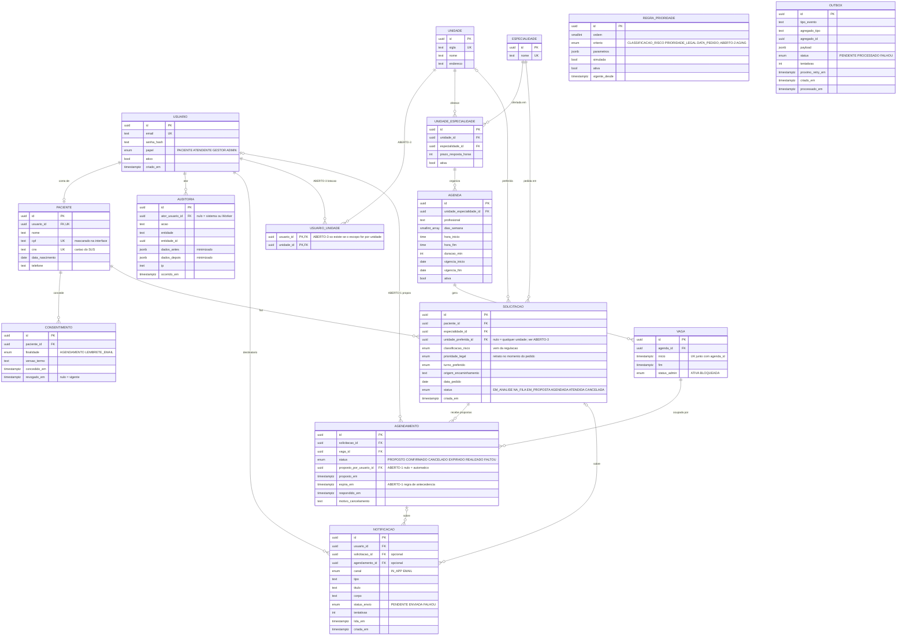

# Modelo de dados

PostgreSQL. Identificadores `uuid`; datas e horas como `timestamptz` ([ADR-008](../decisions/ADR-008-datas-e-fuso.md)). Campos marcados com **ABERTO-n** dependem de [decisões em aberto](../requirements/open-questions.md).



## Restrições

```sql
-- RN-001 / ADR-004: a ocupação da vaga é derivada do agendamento ativo
CREATE UNIQUE INDEX ux_agendamento_vaga_ativa
  ON agendamento (vaga_id)
  WHERE status IN ('PROPOSTO', 'CONFIRMADO');

-- RN-002: no máximo uma proposta ou confirmação ativa por solicitação
CREATE UNIQUE INDEX ux_agendamento_solicitacao_ativa
  ON agendamento (solicitacao_id)
  WHERE status IN ('PROPOSTO', 'CONFIRMADO');

-- Vagas sem duplicata na mesma agenda
ALTER TABLE vaga ADD CONSTRAINT uq_vaga_agenda_inicio UNIQUE (agenda_id, inicio);

-- Uma oferta por unidade e especialidade
ALTER TABLE unidade_especialidade
  ADD CONSTRAINT uq_unidade_especialidade UNIQUE (unidade_id, especialidade_id);

-- Um consentimento vigente por paciente e finalidade
CREATE UNIQUE INDEX ux_consentimento_vigente
  ON consentimento (paciente_id, finalidade)
  WHERE revogado_em IS NULL;

-- Worker: busca eficiente de eventos pendentes e propostas a expirar
CREATE INDEX ix_outbox_pendente ON outbox (proximo_retry_em) WHERE status = 'PENDENTE';
CREATE INDEX ix_agendamento_expiracao ON agendamento (expira_em) WHERE status = 'PROPOSTO';
```

## Observações

- **Vaga livre** = `status_admin = 'ATIVA'` e nenhum agendamento ativo apontando para ela. A tabela `vaga` não guarda "ocupada", para não existir estado duplicado que possa divergir.
- **Prioridade legal** é gravada na solicitação no momento do pedido, para a ordem da fila continuar auditável mesmo que os dados do paciente mudem.
- **Notificação** pode se referir a uma solicitação, a um agendamento ou a nenhum dos dois (avisos de conta).
- **Auditoria** é append-only: a aplicação nunca faz `UPDATE` nem `DELETE` nessa tabela.
- **Outbox** é gravada na mesma transação da mudança de estado e consumida pelo Worker com `FOR UPDATE SKIP LOCKED`.
- Se houver aging (**ABERTO-2**), a ordem da fila passa a depender do tempo e é calculada na consulta, não gravada.
