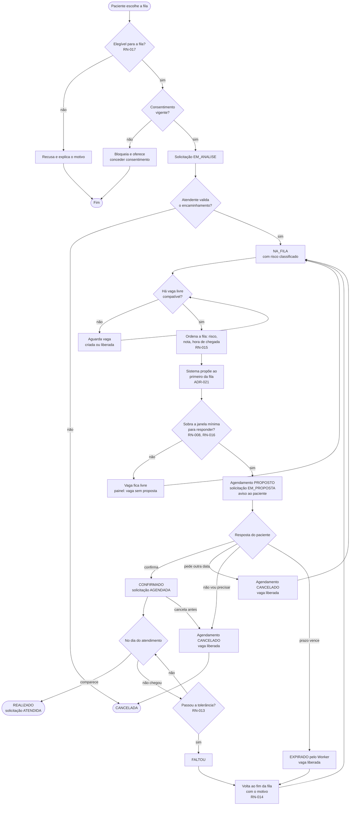

# Atividades — da solicitação ao atendimento

Percurso completo de uma solicitação pela fila, com as decisões e os caminhos alternativos. Os losangos marcados com RN ou ADR seguem as [regras de negócio](../../requirements/business-rules.md) e as decisões da UPE de 15/10/2026.

Toda vaga liberada (cancelamento ou expiração) volta ao losango "Há vaga livre compatível?" para o próximo paciente (RN-005).
