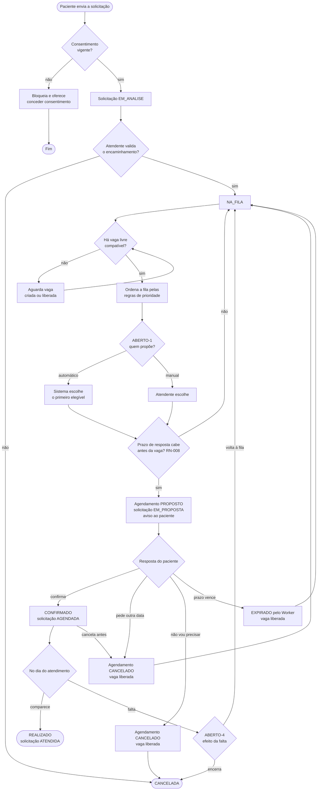

# Atividades — da solicitação ao atendimento

Percurso completo de uma solicitação pela fila, com as decisões e os caminhos alternativos. Os losangos marcados com ABERTO dependem de [questões em aberto](../../requirements/open-questions.md).

Toda vaga liberada (cancelamento ou expiração) volta ao losango "Há vaga livre compatível?" para o próximo paciente (RN-005).
