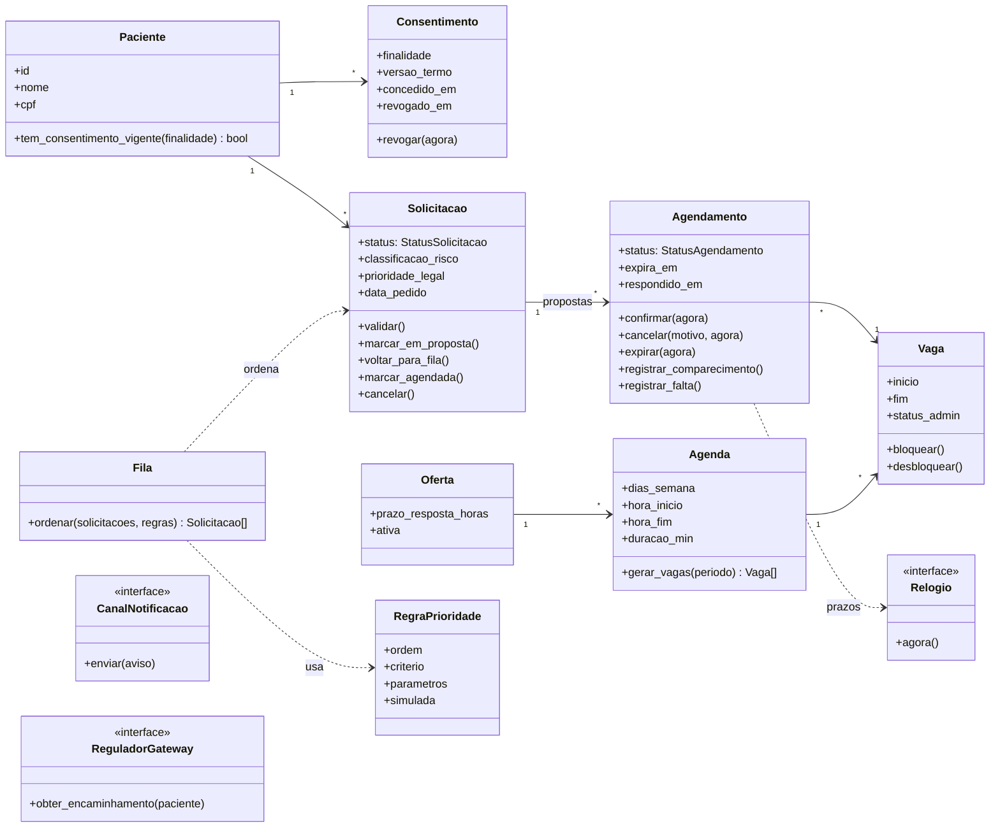

# Diagrama de classes do domínio

Mostra as entidades de `app/dominio` com os métodos que representam as regras de negócio. Os atributos completos e as restrições estão no [modelo de dados](../data-model.md); aqui só aparecem os relevantes para o comportamento.

Notas:

- **Oferta** é a classe de domínio para a tabela `unidade_especialidade` (uma especialidade numa unidade, com prazo de resposta).
- As transições de `Solicitacao` e `Agendamento` levantam erro de domínio quando o estado de origem não permite a operação; a API traduz esse erro em `409`.
- `Fila` é um serviço sem estado: recebe as solicitações e as regras ativas e devolve a ordem. A ordenação fica em `ordenar_fila()`, sem aging no MVP ([ADR-022](../../decisions/ADR-022-ordem-da-fila-sem-aging.md)). Com aging, passa a precisar do `Relogio`.
