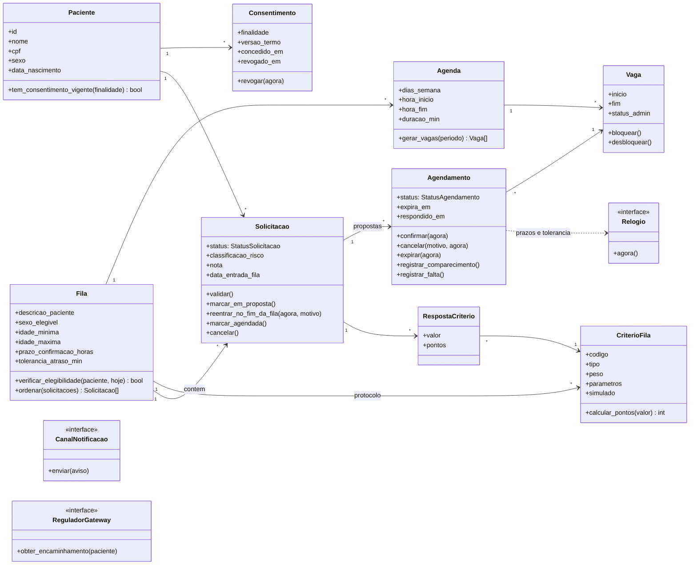

# Diagrama de classes do domínio

Mostra as entidades de `app/dominio` com os métodos que representam as regras de negócio. Os atributos completos e as restrições estão no [modelo de dados](../data-model.md); aqui só aparecem os relevantes para o comportamento.

Notas:

- **Fila** é uma especialidade numa unidade, com descrição, elegibilidade, prazos e protocolo próprios ([ADR-027](../../decisions/ADR-027-fila-como-entidade.md)). Uma especialidade pode ter várias filas.
- As transições de `Solicitacao` e `Agendamento` levantam erro de domínio quando o estado de origem não permite a operação; a API traduz esse erro em `409`.
- A ordem da fila é risco → nota → hora de chegada, calculada por `ordenar_fila()` e nunca gravada ([ADR-024](../../decisions/ADR-024-protocolo-por-fila.md)). A nota é a soma dos pontos das respostas aos critérios da fila.
- Voltar ao fim da fila (proposta expirada ou falta) é uma nova `data_entrada_fila` ([ADR-026](../../decisions/ADR-026-prazos-e-volta-ao-fim-da-fila.md)).
