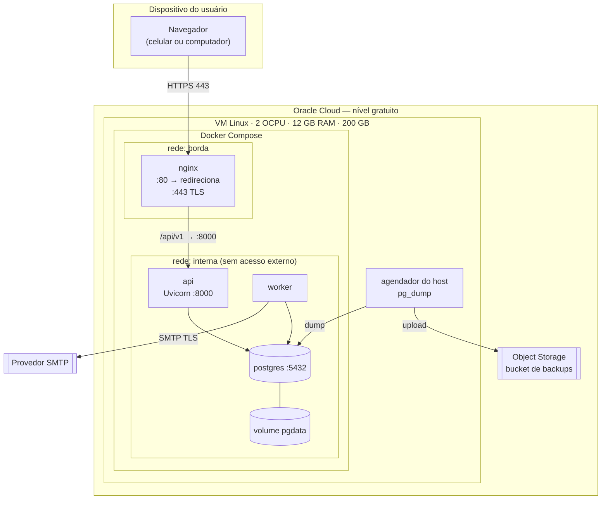

# Diagrama de implantação

Onde cada componente executa no MVP. Portas e nomes de serviço são a proposta para o `docker-compose.yml`; o procedimento está em [implantação](../../operations/deployment.md).

O GitHub Actions roda lint e testes em cada pull request; no MVP ele não publica na VM (implantação manual, ver [implantação](../../operations/deployment.md)).

- Só as portas 80 e 443 ficam abertas na lista de segurança da VM; o SSH é restrito às chaves da equipe.
- `api`, `worker` e `postgres` não publicam portas no host.
- O frontend, depois de compilado, é servido pelo próprio Nginx como arquivos estáticos.
