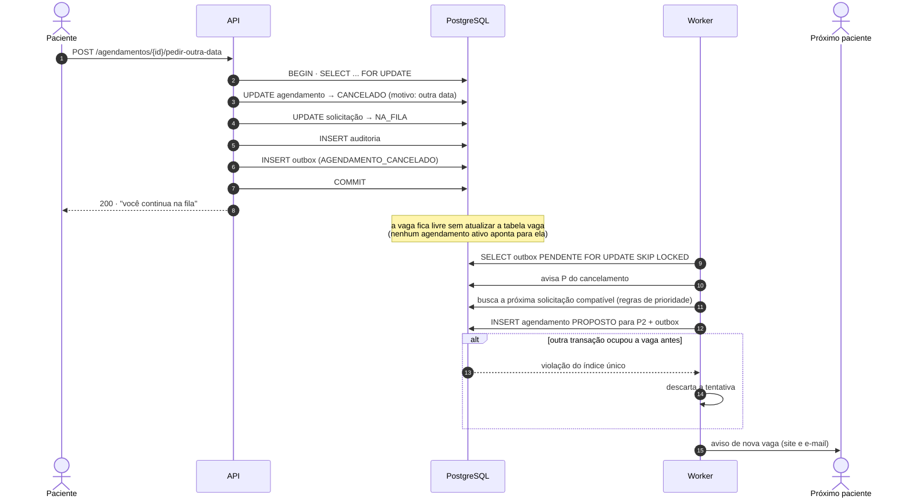

# Sequência — pedir outra data e liberar a vaga

Cenário de [UC-005](../../requirements/use-cases/UC-005-pedir-outra-data-ou-cancelar.md). O trecho final depende de **ABERTO-1**; aqui está a variante automática.

Na variante manual, os passos de matching saem do Worker: a vaga aparece como livre na fila do atendente, que faz a proposta pela API ([UC-003](../../requirements/use-cases/UC-003-propor-vaga.md)).
