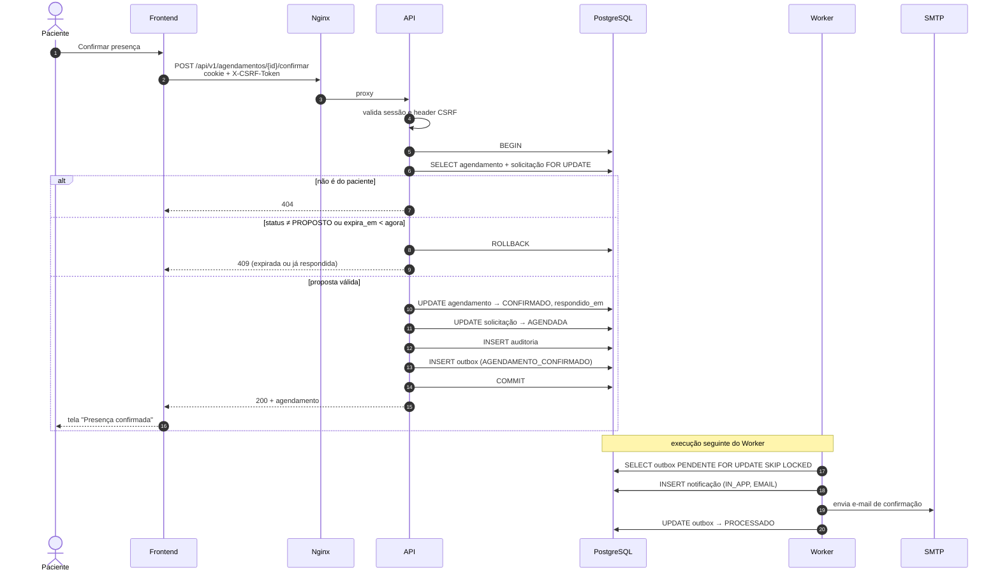

# Sequência — confirmar proposta

Cenário de [UC-004](../../requirements/use-cases/UC-004-confirmar-proposta.md), incluindo a corrida com a expiração.

**Corrida com a expiração:** se o job de expiração pegar o lock primeiro, ele muda o agendamento para `EXPIRADO`. Quando a API obtém o lock, vê o estado diferente de `PROPOSTO` e responde `409`. Se a API vencer, o Worker encontra `CONFIRMADO` e não faz nada.
