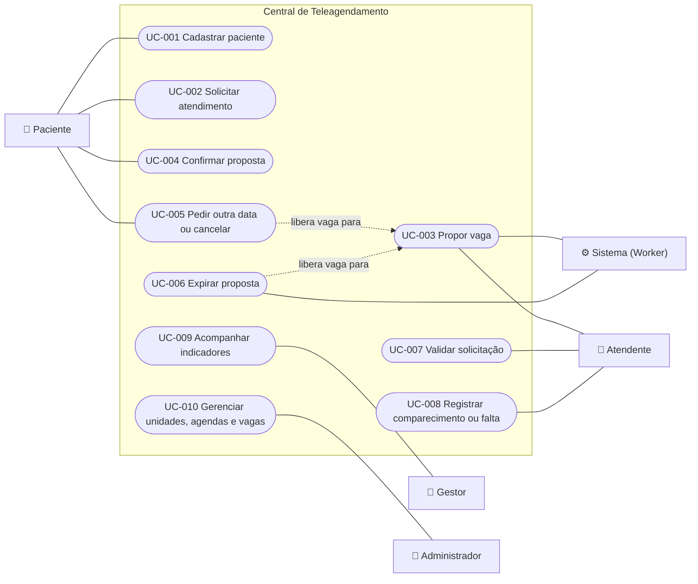

# Diagrama de casos de uso

O Mermaid não tem um tipo nativo de diagrama de casos de uso; este é um equivalente em fluxograma, com os atores à esquerda e à direita e os casos de uso no centro. Detalhes de cada caso em [casos de uso](../../requirements/use-cases/README.md).

UC-003 aparece ligado ao Sistema e ao Atendente porque quem propõe a vaga depende de **ABERTO-1**; só uma das duas ligações vai permanecer.
