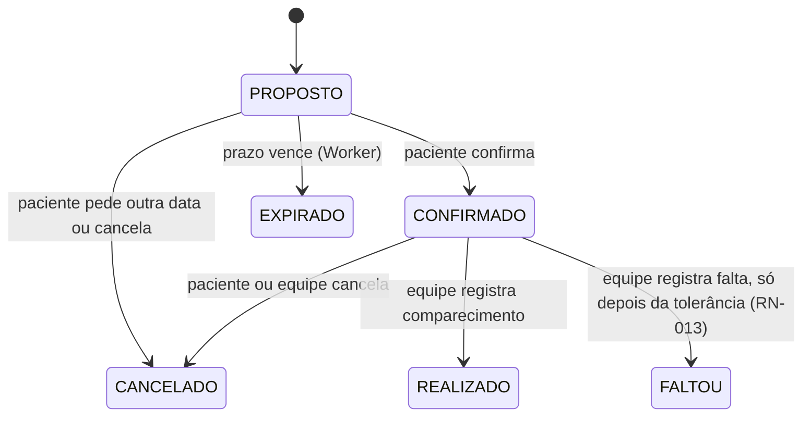
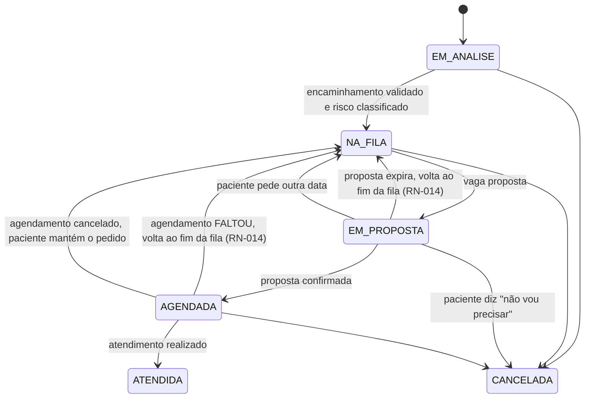

# Regras de negócio

Os termos (solicitação, agendamento, vaga, proposta...) estão definidos no [glossário do PRD](../product/PRD.md#8-glossário).

A separação entre **solicitação** e **agendamento** é a decisão central do domínio: a fila é feita de solicitações, e cada tentativa de encaixe numa vaga é um agendamento novo. Assim o histórico de propostas expiradas, recusadas e canceladas fica preservado.

Cada solicitação pertence a uma **fila** ([ADR-027](../decisions/ADR-027-fila-como-entidade.md)): uma especialidade numa unidade, com descrição, elegibilidade, prazos e protocolo de critérios próprios.

## Ciclo de vida do agendamento

`CANCELADO`, `EXPIRADO`, `REALIZADO` e `FALTOU` são estados finais. Reagendar não altera o agendamento atual: ele é cancelado e uma nova proposta é criada para a mesma solicitação.

## Ciclo de vida da solicitação

Quando o agendamento termina em `FALTOU`, a solicitação volta para `NA_FILA`, no fim da fila ([ADR-026](../decisions/ADR-026-prazos-e-volta-ao-fim-da-fila.md)). Toda mudança de situação da solicitação gera uma linha em `historico_solicitacao`, que alimenta a linha do tempo do paciente (só as linhas com `visivel_paciente = true`) e o motivo da última mudança de posição que a equipe vê.

## Regras

| ID | Regra | Decisão relacionada |
| --- | --- | --- |
| RN-001 | Uma vaga só pode estar ocupada por um agendamento `PROPOSTO` ou `CONFIRMADO` de cada vez. Isso é garantido pelo banco, não pela aplicação | [ADR-004](../decisions/ADR-004-ocupacao-da-vaga.md) |
| RN-002 | Uma solicitação tem no máximo um agendamento ativo (`PROPOSTO` ou `CONFIRMADO`) por vez | — |
| RN-003 | Toda proposta tem prazo de resposta (`expira_em`, ver RN-012). Vencido o prazo, a proposta vira `EXPIRADO` e a solicitação volta para `NA_FILA`, no fim da fila (RN-014) | [ADR-005](../decisions/ADR-005-worker-separado.md), [ADR-026](../decisions/ADR-026-prazos-e-volta-ao-fim-da-fila.md) |
| RN-004 | "Pedir outra data" cancela o agendamento atual e mantém o paciente na fila. "Não vou precisar" cancela o agendamento e a solicitação | — |
| RN-005 | Vaga liberada por cancelamento ou expiração volta a ser elegível para o próximo paciente da fila | — |
| RN-006 | Cada fila tem um protocolo de critérios com peso (`criterio_fila`). Cada resposta vale pontos; a **nota** da solicitação é a soma dos pontos, recalculada pelo domínio a cada resposta gravada. Prioridade legal é um critério com peso, não uma coluna. Os critérios do protótipo são simulados; os oficiais são da instituição. Sem aging | [ADR-011](../decisions/ADR-011-regras-de-prioridade.md), [ADR-024](../decisions/ADR-024-protocolo-por-fila.md) |
| RN-007 | O paciente vê o status da solicitação e a linha do tempo com os motivos das mudanças, nunca a posição na fila nem o tamanho dela. A posição e o motivo da última mudança de posição aparecem só para a equipe | [ADR-007](../decisions/ADR-007-paciente-ve-status.md) |
| RN-008 | O prazo de resposta nunca ultrapassa o horário da vaga menos a antecedência mínima (`PROPOSTA_ANTECEDENCIA_MINIMA_HORAS`, padrão 24 horas): `expira_em` é o menor entre o prazo da fila (RN-012) e esse limite | [ADR-021](../decisions/ADR-021-matching-automatico.md) |
| RN-009 | Sem consentimento vigente para a finalidade `AGENDAMENTO`, o paciente não cria solicitações. Lembretes por e-mail exigem o consentimento separado `LEMBRETE_EMAIL` | [proteção de dados](../security/data-protection.md) |
| RN-010 | Toda mudança de estado de solicitação ou agendamento gera registro de auditoria com o ator (usuário ou sistema) | [visão de segurança](../security/security-overview.md) |
| RN-011 | Toda mudança de estado que precisa avisar o paciente grava um evento na outbox, na mesma transação | [ADR-006](../decisions/ADR-006-outbox.md) |
| RN-012 | O prazo para confirmar a vaga é definido pela fila (`fila.prazo_confirmacao_horas`), com padrão de 2 dias (48 horas) | [ADR-026](../decisions/ADR-026-prazos-e-volta-ao-fim-da-fila.md) |
| RN-013 | No dia da consulta, o paciente tem a tolerância de atraso da fila (`fila.tolerancia_atraso_min`, padrão 1 hora). A falta só pode ser registrada depois de `início da vaga + tolerância`; exatamente no limite ainda não é falta | [ADR-026](../decisions/ADR-026-prazos-e-volta-ao-fim-da-fila.md) |
| RN-014 | Voltar para o **fim da fila** significa receber uma nova hora de chegada: `data_entrada_fila = agora`. Acontece quando a proposta expira e quando o paciente falta. A solicitação mantém o risco e a nota. O paciente recebe o motivo ("você não confirmou a vaga no prazo", "você não compareceu à consulta"), nunca a posição | [ADR-026](../decisions/ADR-026-prazos-e-volta-ao-fim-da-fila.md) |
| RN-015 | A fila é ordenada por: (1) classificação de risco, `VERMELHO`, `AMARELO`, `VERDE`; (2) nota, da maior para a menor; (3) hora de chegada na fila (`data_entrada_fila`), da mais antiga para a mais nova. Solicitação sem classificação de risco não entra na fila | [ADR-024](../decisions/ADR-024-protocolo-por-fila.md) |
| RN-016 | Se o prazo calculado deixar menos que a janela mínima (`PROPOSTA_JANELA_MINIMA_HORAS`, padrão 12 horas) para o paciente responder, a vaga não é proposta. Ela fica livre e aparece no painel como "vaga sem proposta". Exatamente 12 horas ainda permitem propor | [ADR-021](../decisions/ADR-021-matching-automatico.md) |
| RN-017 | O paciente só entra numa fila se cumprir a elegibilidade dela: sexo (`sexo_elegivel`) e idade em anos completos entre `idade_minima` e `idade_maxima`, limites inclusivos, contada na data de hoje em `America/Recife`. Fila sem restrição aceita qualquer paciente. Paciente sem sexo ou sem data de nascimento é inelegível para filas que restringem esses dados | [ADR-027](../decisions/ADR-027-fila-como-entidade.md) |
