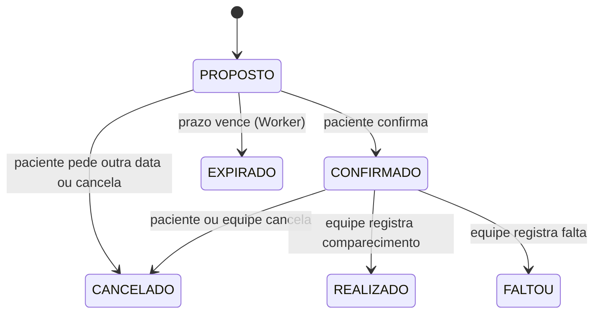
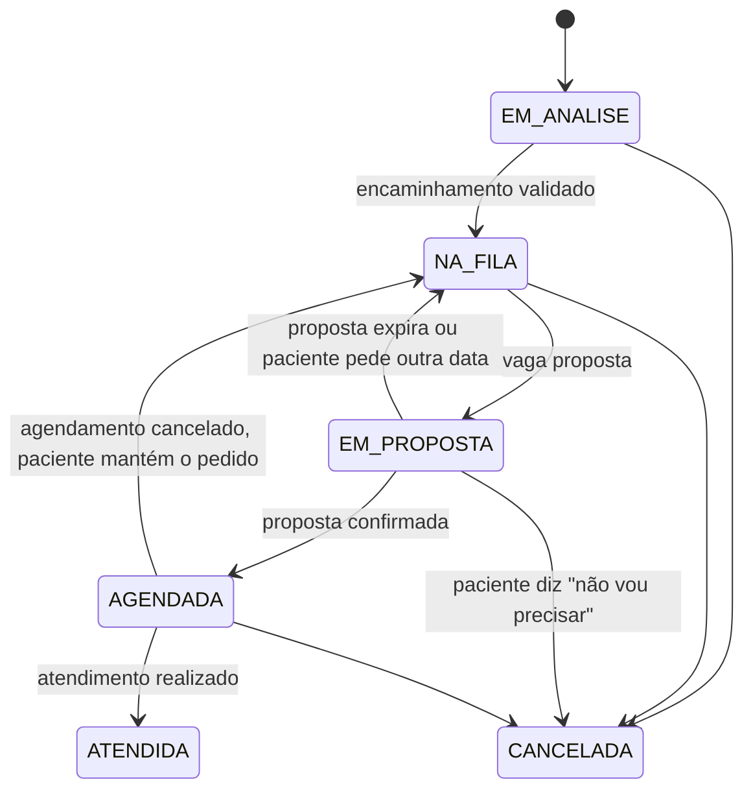

# Regras de negócio

Os termos (solicitação, agendamento, vaga, proposta...) estão definidos no [glossário do PRD](../product/PRD.md#8-glossário).

A separação entre **solicitação** e **agendamento** é a decisão central do domínio: a fila é feita de solicitações, e cada tentativa de encaixe numa vaga é um agendamento novo. Assim o histórico de propostas expiradas, recusadas e canceladas fica preservado.

## Ciclo de vida do agendamento

`CANCELADO`, `EXPIRADO`, `REALIZADO` e `FALTOU` são estados finais. Reagendar não altera o agendamento atual: ele é cancelado e uma nova proposta é criada para a mesma solicitação.

## Ciclo de vida da solicitação

O efeito de `FALTOU` sobre a solicitação ainda não foi definido (**ABERTO-4** em [questões em aberto](open-questions.md)).

## Regras

| ID | Regra | Decisão relacionada |
| --- | --- | --- |
| RN-001 | Uma vaga só pode estar ocupada por um agendamento `PROPOSTO` ou `CONFIRMADO` de cada vez. Isso é garantido pelo banco, não pela aplicação | [ADR-004](../decisions/ADR-004-ocupacao-da-vaga.md) |
| RN-002 | Uma solicitação tem no máximo um agendamento ativo (`PROPOSTO` ou `CONFIRMADO`) por vez | — |
| RN-003 | Toda proposta tem prazo de resposta, definido pelo `prazo_resposta_horas` da especialidade naquela unidade. Vencido o prazo, a proposta vira `EXPIRADO` e a solicitação volta para `NA_FILA` | [ADR-005](../decisions/ADR-005-worker-separado.md) |
| RN-004 | "Pedir outra data" cancela o agendamento atual e mantém o paciente na fila. "Não vou precisar" cancela o agendamento e a solicitação | — |
| RN-005 | Vaga liberada por cancelamento ou expiração volta a ser elegível para o próximo paciente da fila | — |
| RN-006 | A fila é ordenada pelas regras ativas em `regra_prioridade`, aplicadas em sequência. Regras de exemplo: classificação de risco da regulação, depois prioridade legal, depois data do pedido. São simuladas; os critérios oficiais são da instituição (**ABERTO-2**) | [ADR-011](../decisions/ADR-011-regras-de-prioridade.md) |
| RN-007 | O paciente vê apenas o status da solicitação, nunca a posição numérica na fila | [ADR-007](../decisions/ADR-007-paciente-ve-status.md) |
| RN-008 | Não se propõe uma vaga se o prazo de resposta ultrapassar o horário da vaga, menos uma antecedência mínima (**ABERTO-1**) | — |
| RN-009 | Sem consentimento vigente para a finalidade `AGENDAMENTO`, o paciente não cria solicitações. Lembretes por e-mail exigem o consentimento separado `LEMBRETE_EMAIL` | [proteção de dados](../security/data-protection.md) |
| RN-010 | Toda mudança de estado de solicitação ou agendamento gera registro de auditoria com o ator (usuário ou sistema) | [visão de segurança](../security/security-overview.md) |
| RN-011 | Toda mudança de estado que precisa avisar o paciente grava um evento na outbox, na mesma transação | [ADR-006](../decisions/ADR-006-outbox.md) |
