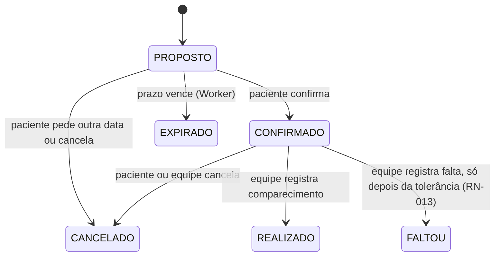
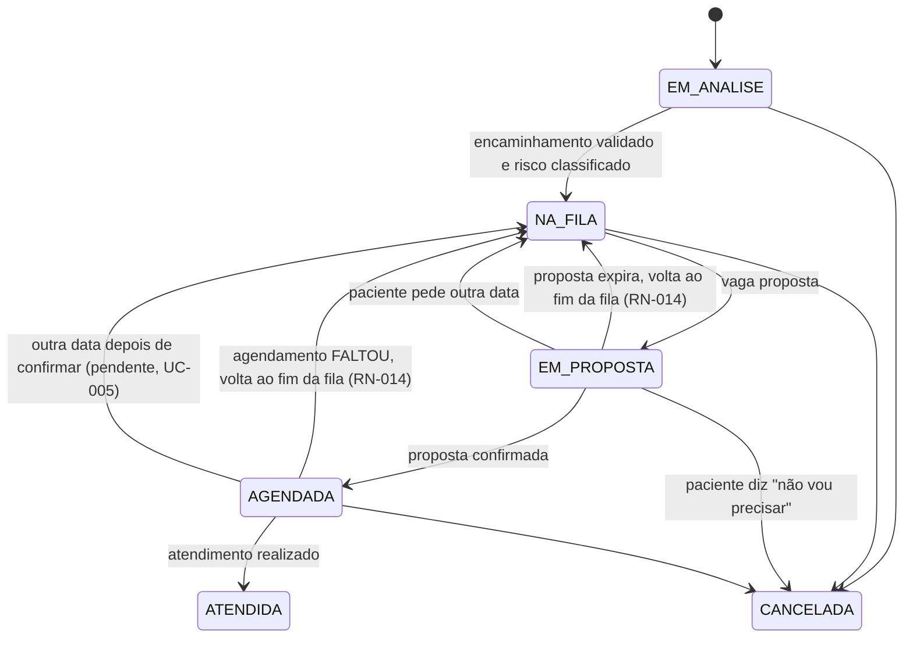

# Regras de negócio

Os termos (solicitação, agendamento, vaga, proposta...) estão definidos no [glossário do PRD](../product/PRD.md#8-glossário).

A separação entre **solicitação** e **agendamento** é a decisão central do domínio: a fila é feita de solicitações, e cada tentativa de encaixe numa vaga é um agendamento novo. Assim o histórico de propostas expiradas, recusadas e canceladas fica preservado.

Cada solicitação pertence a uma **fila** ([ADR-027](../decisions/ADR-027-fila-como-entidade.md)): uma especialidade numa unidade, com descrição, elegibilidade, prazos e protocolo de critérios próprios.

## Ciclo de vida do agendamento

`CANCELADO`, `EXPIRADO`, `REALIZADO` e `FALTOU` são estados finais. Reagendar não altera o agendamento atual: ele é cancelado e uma nova proposta é criada para a mesma solicitação.

## Ciclo de vida da solicitação

**Cancelamento pelo paciente:** vale em `EM_ANALISE`, `NA_FILA`, `EM_PROPOSTA` e `AGENDADA` ([UC-005](use-cases/UC-005-pedir-outra-data-ou-cancelar.md), A1). Com proposta ou consulta ativa, o agendamento vai para `CANCELADO` (motivo `CANCELADO_PELO_PACIENTE`) na mesma transação, só antes do início da vaga; depois disso, `409`. A vaga fica livre e o Worker a oferece ao próximo da fila (RN-005). A equipe só grava respostas de critérios em `EM_ANALISE` e `NA_FILA`. Reclassificar um pedido que já está `NA_FILA` exige motivo. O motivo do cancelamento pelo paciente é um código de lista fechada.

**Pendência:** `AGENDADA` → `NA_FILA` por "pedir outra data" depois de confirmar ainda não está implementado (decisão do grupo e da UPE). Por ora o paciente cancela e abre nova solicitação ([UC-005](use-cases/UC-005-pedir-outra-data-ou-cancelar.md)).

Quando o agendamento termina em `FALTOU`, a solicitação volta para `NA_FILA`, no fim da fila ([ADR-026](../decisions/ADR-026-prazos-e-volta-ao-fim-da-fila.md)). Toda mudança de situação da solicitação gera uma linha em `historico_solicitacao`, que alimenta a linha do tempo do paciente (só as linhas com `visivel_paciente = true`) e o motivo da última mudança de posição que a equipe vê.

## Regras

| ID | Regra | Decisão relacionada |
| --- | --- | --- |
| RN-001 | Uma vaga só pode estar ocupada por um agendamento `PROPOSTO` ou `CONFIRMADO` de cada vez. Isso é garantido pelo banco, não pela aplicação | [ADR-004](../decisions/ADR-004-ocupacao-da-vaga.md) |
| RN-002 | Uma solicitação tem no máximo um agendamento ativo (`PROPOSTO` ou `CONFIRMADO`) por vez | — |
| RN-003 | Toda proposta tem prazo de resposta (`expira_em`, ver RN-012). Vencido o prazo, a proposta vira `EXPIRADO` e a solicitação volta para `NA_FILA`, no fim da fila (RN-014) | [ADR-005](../decisions/ADR-005-worker-separado.md), [ADR-026](../decisions/ADR-026-prazos-e-volta-ao-fim-da-fila.md) |
| RN-004 | "Pedir outra data" cancela o agendamento atual (motivo `RECUSADO_PELO_PACIENTE`) e mantém o paciente na fila, conforme RN-020; por ora só com o agendamento `PROPOSTO`. "Não vou precisar" cancela o agendamento (`CANCELADO_PELO_PACIENTE`) e a solicitação, só antes do início da vaga | [UC-005](use-cases/UC-005-pedir-outra-data-ou-cancelar.md) |
| RN-005 | Vaga liberada por cancelamento, recusa ou expiração volta a ser elegível para o próximo paciente da fila (**reaproveitamento**), desde que ainda caiba a janela mínima (RN-016). Nunca é reoferecida à mesma solicitação | [ADR-004](../decisions/ADR-004-ocupacao-da-vaga.md) |
| RN-006 | Cada fila tem um protocolo de critérios com peso (`criterio_fila`). Cada resposta vale pontos; a **nota** da solicitação é a soma dos pontos, recalculada pelo domínio a cada resposta gravada. Prioridade legal é um critério com peso, não uma coluna. Os critérios do protótipo são simulados; os oficiais são da instituição. Sem aging | [ADR-011](../decisions/ADR-011-regras-de-prioridade.md), [ADR-024](../decisions/ADR-024-protocolo-por-fila.md) |
| RN-007 | O paciente vê o status da solicitação e a linha do tempo com os motivos das mudanças, nunca a posição na fila nem o tamanho dela. A posição e o motivo da última mudança de posição aparecem só para a equipe | [ADR-007](../decisions/ADR-007-paciente-ve-status.md) |
| RN-008 | O prazo de resposta nunca ultrapassa o horário da vaga menos a antecedência mínima (`PROPOSTA_ANTECEDENCIA_MINIMA_HORAS`, padrão 24 horas): `expira_em` é o menor entre o prazo da fila (RN-012) e esse limite | [ADR-021](../decisions/ADR-021-matching-automatico.md) |
| RN-009 | Sem consentimento vigente para a finalidade `AGENDAMENTO`, o paciente não cria solicitações. Lembretes por e-mail exigem o consentimento separado `LEMBRETE_EMAIL` | [proteção de dados](../security/data-protection.md) |
| RN-010 | Toda mudança de estado de solicitação ou agendamento gera registro de auditoria com o ator (usuário ou sistema) | [visão de segurança](../security/security-overview.md) |
| RN-011 | Toda mudança de estado que precisa avisar o paciente grava um evento na outbox, na mesma transação | [ADR-006](../decisions/ADR-006-outbox.md) |
| RN-012 | O prazo para confirmar a vaga é definido pela fila (`fila.prazo_confirmacao_horas`), com padrão de 2 dias (48 horas) | [ADR-026](../decisions/ADR-026-prazos-e-volta-ao-fim-da-fila.md) |
| RN-013 | No dia da consulta, o paciente tem a tolerância de atraso da fila (`fila.tolerancia_atraso_min`, padrão 1 hora). A falta só pode ser registrada depois de `início da vaga + tolerância`; exatamente no limite ainda não é falta. O comparecimento só pode ser registrado a partir do início da vaga | [ADR-026](../decisions/ADR-026-prazos-e-volta-ao-fim-da-fila.md) |
| RN-014 | Voltar para o **fim da fila** significa receber uma nova hora de chegada: `data_entrada_fila = agora`. Acontece quando a proposta expira, quando o paciente falta e na recusa além do limite (RN-020). A solicitação mantém o risco e a nota. O paciente recebe o motivo ("você não confirmou a vaga no prazo", "você não compareceu à consulta"), nunca a posição | [ADR-026](../decisions/ADR-026-prazos-e-volta-ao-fim-da-fila.md) |
| RN-015 | A fila é ordenada por: (1) classificação de risco, `VERMELHO`, `AMARELO`, `VERDE`; (2) nota, da maior para a menor; (3) hora de chegada na fila (`data_entrada_fila`), da mais antiga para a mais nova. Solicitação sem classificação de risco não entra na fila | [ADR-024](../decisions/ADR-024-protocolo-por-fila.md) |
| RN-016 | Se o prazo calculado deixar menos que a janela mínima (`PROPOSTA_JANELA_MINIMA_HORAS`, padrão 12 horas) para o paciente responder, a vaga não é proposta. Ela fica livre e aparece no painel como "vaga sem proposta". Exatamente 12 horas ainda permitem propor | [ADR-021](../decisions/ADR-021-matching-automatico.md) |
| RN-017 | O paciente só entra numa fila se cumprir a elegibilidade dela: sexo (`sexo_elegivel`) e idade em anos completos entre `idade_minima` e `idade_maxima`, limites inclusivos, contada na data de hoje em `America/Recife`. Fila sem restrição aceita qualquer paciente. Paciente sem sexo ou sem data de nascimento é inelegível para filas que restringem esses dados | [ADR-027](../decisions/ADR-027-fila-como-entidade.md) |
| RN-018 | Cada paciente tem no máximo uma solicitação ativa (status fora de `ATENDIDA` e `CANCELADA`) por fila, garantida pelo índice único parcial `ux_solicitacao_ativa_por_fila`. A segunda tentativa responde `409` com o ID da solicitação existente. Depois de encerrada, uma nova é permitida | [data-model](../architecture/data-model.md) |
| RN-019 | Turno da vaga pela hora local de início em `America/Recife`: antes de 12h é `MANHA`; a partir de 12h, `TARDE`. A solicitação com `turno_preferido` `QUALQUER` aceita as duas. O matching pula quem prefere outro turno | [UC-003](use-cases/UC-003-propor-vaga.md) |
| RN-020 | *(Proposta; validar com o grupo e a UPE.)* Recusas contam só desde a última entrada na fila (`data_entrada_fila`). As primeiras `RECUSAS_MANTENDO_POSICAO` (padrão 1) mantêm a posição; a seguinte manda a solicitação para o fim da fila (RN-014), e a contagem zera | [UC-005](use-cases/UC-005-pedir-outra-data-ou-cancelar.md) |
| RN-021 | Os indicadores do gestor seguem as fórmulas da seção [Indicadores do gestor](#indicadores-do-gestor-rn-021): cada família de contagens tem a própria âncora de tempo, as semanas são as de Recife (segunda-feira) e razão com denominador 0 é `null`. Proposta cancelada sem resposta fica fora das taxas; "ocupadas" inclui vagas futuras; filas inativas contam | [API](../architecture/api-design.md#indicadores-do-gestor) |
| RN-022 | Conta criada ou redefinida pelo admin (ou pelo terminal do servidor) nasce com senha temporária e só pode trocar a senha: toda rota autenticada responde `403` até a troca, menos `/me`, `/auth/trocar-senha`, `/auth/logout` e `/auth/refresh`. A senha nova tem ao menos 10 caracteres e é diferente da atual. A troca revoga as outras sessões do usuário. Errar a senha atual conta no limite de tentativas do login (AM-020) | [controle de acesso](../security/access-control.md), [API](../architecture/api-design.md#sessão-cookies-e-csrf) |

## Indicadores do gestor (RN-021)

Para as filas do escopo do usuário (e, se pedido, só a unidade ou a fila indicada), dentro de um período de 1 a 366 dias (inclusivos, em `America/Recife`). Cada contagem é agrupada pela **semana de Recife** (segunda-feira) da sua âncora; o total do período é a soma das semanas. Uma conta nunca mistura âncoras: uma proposta feita na semana 1 e confirmada na 2 conta na semana 1.

| Família | Âncora de tempo | Contagens |
| --- | --- | --- |
| Propostas | `agendamento.proposto_em` | `confirmadas`, `recusadas`, `expiradas`, `propostas_canceladas_sem_resposta` |
| Atendimento | `vaga.inicio` | `realizadas`, `faltas` |
| Solicitações | `solicitacao.criada_em` | `solicitacoes_criadas`, `desistencias` |
| Vagas | `vaga.inicio` | `vagas_ofertadas`, `vagas_ocupadas`, `vagas_reaproveitadas`, `vagas_perdidas` |

**Propostas** (cada agendamento é uma proposta, [ADR-021](../decisions/ADR-021-matching-automatico.md)):

- `confirmadas`: propostas com `confirmado_em` preenchido. **Uma confirmação que o paciente cancelou depois continua confirmada**: a proposta foi aceita, e o cancelamento aparece nas desistências e na vaga liberada.
- `recusadas`: `CANCELADO` com motivo `RECUSADO_PELO_PACIENTE`.
- `expiradas`: `EXPIRADO`.
- `propostas_encerradas` = `confirmadas` + `recusadas` + `expiradas`. É o denominador das três taxas: `taxa_confirmacao`, `taxa_recusa` e `taxa_expiracao` (cada uma ÷ `propostas_encerradas`). Proposta ainda `PROPOSTO` não entra, porque ainda não tem desfecho.
- `propostas_canceladas_sem_resposta`: `CANCELADO` sem `confirmado_em` e sem ser recusa (por exemplo, o paciente cancelou a solicitação com a proposta aberta). **Fica à parte e fora das taxas**: não é confirmação, recusa nem expiração, e somá-la distorceria as três.

**Atendimento:** `realizadas` (`REALIZADO`) e `faltas` (`FALTOU`) das vagas que começaram no recorte. `taxa_faltas` = `faltas` ÷ (`realizadas` + `faltas`).

**Solicitações:** `solicitacoes_criadas` e, dessas, `desistencias` (status atual `CANCELADA` com motivo, isto é, cancelada pelo paciente). `taxa_desistencia` = `desistencias` ÷ `solicitacoes_criadas`. A âncora é a criação, então a taxa de uma semana recente ainda pode subir.

**Vagas** (só `status_admin = 'ATIVA'`; vaga bloqueada não é oferta):

- `vagas_ofertadas`: vagas ativas que começam no recorte.
- `vagas_ocupadas`: ofertadas com agendamento `CONFIRMADO`, `REALIZADO` ou `FALTOU`. **Inclui vagas futuras já confirmadas**: nem toda "ocupada" já foi atendida. Para o que já aconteceu, use `realizadas` e `faltas`.
- `vagas_reaproveitadas`: ocupadas cujo agendamento confirmado foi precedido, na mesma vaga, por uma proposta desfeita (`CANCELADO` ou `EXPIRADO`) de **outra** solicitação ([RN-005](#regras)).
- `vagas_perdidas`: ofertadas que já começaram (`inicio` anterior a agora) sem agendamento `CONFIRMADO`, `REALIZADO` ou `FALTOU`.

**Tempo de espera:** das solicitações cuja **primeira confirmação** cai no período, a diferença em dias entre a primeira entrada na fila (`ENTROU_NA_FILA` mais antiga) e essa confirmação. Devolve a quantidade, a mediana e o percentil 90 (interpolados), com 2 casas. Uma volta ao fim da fila (RN-014) não reinicia a contagem. Se duas confirmações da mesma solicitação tiverem exatamente o mesmo `confirmado_em`, as duas contam como "primeira" (empate aceito).

**Fila atual:** solicitações `NA_FILA` agora, por cor de risco. Não depende do período.

**Decisões aceitas:**
- filas **inativas** entram nas contas (a história delas continua valendo); o filtro `unidade_id` de uma unidade sem nenhuma fila no escopo responde `404`, e esse `404` não é auditado;
- as taxas só têm sentido quando o denominador é maior que 0; senão a resposta traz `null`, nunca `0`;
- vagas e propostas de dados anteriores à migração 0007 podem ter `confirmado_em` aproximado ([modelo de dados](../architecture/data-model.md)).
