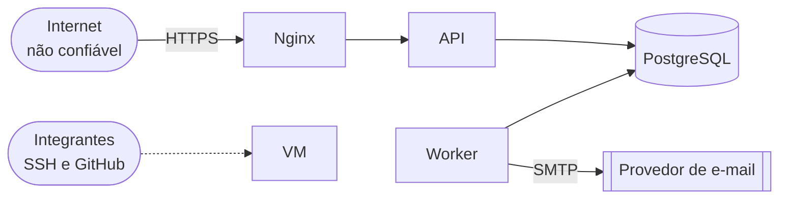

# Modelo de ameaças

Método: STRIDE aplicado aos pontos de entrada do sistema. **Impacto** e **probabilidade** são estimativas da equipe (Alto, Médio, Baixo) para priorizar o trabalho do MVP.

## Pontos de entrada e fronteiras de confiança

| Ponto de entrada | Quem alcança |
| --- | --- |
| `POST /auth/registro`, `POST /auth/login` | Qualquer pessoa na internet; sem CSRF, limitados por IP e por identificador (AM-004) |
| `POST /auth/refresh`, `POST /auth/logout` | Quem tem o cookie `refresh_token`; exigem CSRF |
| Rotas do paciente com ID (`/agendamentos/{id}`, `/solicitacoes/{id}`) | Pacientes autenticados |
| Rotas da equipe (fila, validação, indicadores, auditoria) | Atendentes, gestores e admins |
| E-mails enviados | Quem tiver acesso à caixa de entrada do paciente |
| SSH na VM, repositório no GitHub | Integrantes da equipe |

## Ameaças

| ID | STRIDE | Ameaça | Impacto | Prob. | Mitigação | Situação |
| --- | --- | --- | --- | --- | --- | --- |
| AM-001 | Divulgação | Paciente troca o ID na URL e vê ou altera o agendamento de outra pessoa (IDOR) | Alto | Alta | Toda consulta da área do paciente filtra pelo paciente da sessão; recurso alheio responde `404`; teste de acesso negado por rota | Decidido |
| AM-002 | Falsificação | Site malicioso dispara uma ação usando o cookie do paciente (CSRF) | Alto | Média | `SameSite` no cookie + double-submit: o header `X-CSRF-Token` tem de ser igual ao cookie `csrf_token`, em todo `POST`, `PUT`, `PATCH` e `DELETE` (menos registro e login). **Premissa:** não existem subdomínios não confiáveis, porque o valor não é assinado e um subdomínio hostil poderia plantar o cookie | Implementado |
| AM-003 | Falsificação | Script injetado rouba a sessão (XSS), ou o refresh token é roubado de outra forma | Alto | Média | Tokens em cookie `httpOnly`; escape automático do frontend; `Content-Security-Policy`. Refresh token com **rotação e detecção de reuso**: reapresentar um token já substituído revoga a família inteira. O access token leva o `sid` (família) e cai na hora com o logout, o reuso ou a suspensão. **Tolerância de 10 s** (`REFRESH_TOLERANCIA_S`) para duas abas renovarem juntas sem contar como reuso, aceita **uma única vez por token** (`sessao_refresh.reapresentado_em`): a segunda reapresentação revoga a família | Implementado; CSP proposta |
| AM-004 | Negação de serviço / Falsificação | Força bruta de senhas ou criação de contas em massa | Médio | Média | Login limitado por IP e por identificador: `LOGIN_MAX_TENTATIVAS=5` falhas em `LOGIN_JANELA_MIN=15` min, com bloqueio temporário de 15 min (`429` com `Retry-After`). Registro limitado por IP: `REGISTRO_MAX_TENTATIVAS=20` na mesma janela. Identificador guardado só como HMAC-SHA256 | Implementado |
| AM-005 | Divulgação | Descobrir quais CPFs têm conta pelas mensagens de login ou cadastro | Médio | Alta | Login responde igual (mesmo corpo) para inexistente, senha errada e suspenso, com hash fictício para igualar o tempo; o paciente não entra por e-mail. Registro: `409` genérico para CPF, cartão do SUS ou e-mail duplicado | Implementado (UC-001); enumeração de CPF pelo `409` do registro é risco aceito, mitigado pelo limite de registro por IP |
| AM-006 | Adulteração | Duas propostas simultâneas entregam a mesma vaga a dois pacientes | Alto | Média | Índice único parcial; teste de concorrência | Decidido |
| AM-007 | Divulgação | Atendente consulta dados de pacientes de filas em que não trabalha | Médio | Média | Escopo por fila via `escopo_da_equipe()`, aplicado dentro da query; recurso fora do escopo responde `404`; auditoria das consultas da equipe | Decidido ([ADR-025](../decisions/ADR-025-escopo-por-fila.md)) |
| AM-008 | Divulgação | Dados pessoais aparecem em logs ou no corpo dos e-mails | Médio | Alta | Logs sem CPF, nome nem corpo de requisição; e-mail com o mínimo e link para o site | Proposto |
| AM-009 | Divulgação | Segredos (senha do banco, chave de token) vazam pelo repositório | Alto | Média | `.env` no `.gitignore`; varredura de segredos na CI; rotação se vazar. Em produção, a API não sobe com o `JWT_SECRET_KEY` ou o `LOGIN_HASH_KEY` de exemplo, com segredo de menos de 32 caracteres, com as duas chaves iguais ou com `COOKIE_SECURE=false`. `APP_ENV` é obrigatório, sem padrão: um ambiente esquecido não sobe como `development` e escapa dessas checagens; valor fora de `development`, `test` e `production` impede a inicialização | Parcial |
| AM-010 | Adulteração | Injeção de SQL | Alto | Baixa | ORM ou consultas parametrizadas; validação com Pydantic | Decidido |
| AM-011 | Repúdio | Alguém nega ter cancelado ou confirmado | Médio | Baixa | Auditoria append-only com ator, data e IP | Decidido |
| AM-012 | Negação de serviço | Perda da VM ou do disco apaga o banco | Alto | Baixa | Backup fora da VM com restauração testada | Decidido |
| AM-013 | Elevação de privilégio | Paciente envia `papel`, `classificacao_risco` ou `status` no corpo e o sistema aceita (atribuição em massa) | Alto | Média | Schemas de entrada explícitos, sem esses campos; o papel nunca vem do cliente. No registro, `extra="forbid"` recusa campo não previsto com `422` | Implementado no registro; demais rotas conforme forem criadas |
| AM-014 | Divulgação | A API do paciente expõe posição na fila, tamanho da fila, nota ou dados de outros pacientes, inclusive pela linha do tempo | Médio | Média | Schemas de resposta do paciente sem posição, tamanho, nota nem dados de terceiros (RN-007); a posição é calculada na consulta e nunca gravada; `historico_solicitacao` não guarda posição e o paciente vê só eventos com `visivel_paciente = true`; os motivos de volta à fila são textos fixos, sem número | Decidido (mantido pela UPE em 15/10/2026, [ADR-007](../decisions/ADR-007-paciente-ve-status.md)) |
| AM-015 | Falsificação | E-mail falso imitando a central leva o paciente a uma página de login falsa | Médio | Média | Avisos sempre direcionam para o domínio oficial; o site nunca pede senha por e-mail | Proposto |
| AM-016 | Adulteração / Elevação de privilégio | Operador "fura a fila" de um conhecido: reclassifica o risco, altera respostas de critérios, marca falta indevida em outro paciente ou mexe em filas que não são suas | Alto | Média | Escopo por fila: o atendente só opera as filas atribuídas ([ADR-025](../decisions/ADR-025-escopo-por-fila.md)); ordem calculada só pelo domínio (`ordenar_fila()`), sem campo de posição editável; nota e pontos calculados no servidor; falta só depois da tolerância (RN-013); reclassificação e falta registradas em `historico_solicitacao` e na auditoria append-only, com o ator | Decidido |
| AM-017 | Elevação de privilégio | Profissional desligado ou de férias continua acessando o sistema | Médio | Média | Suspensão em vez de exclusão: usuário `SUSPENSO` não faz login, não renova o refresh token e não tem escopo ([ADR-028](../decisions/ADR-028-suspensao-de-acesso.md)) | Implementado: suspender revoga todas as sessões e `usuario_da_sessao` recusa o access token na próxima requisição |

## Riscos aceitos e premissas da autenticação

| Item | Risco | Por que aceitamos |
| --- | --- | --- |
| Bloqueio por CPF (AM-004) | Quem sabe o CPF de outra pessoa pode travar o login dela por 15 min | Alternativa seria não limitar por identificador; o bloqueio é curto e não revela se a conta existe |
| Bloqueio por IP (AM-004) | Atrás de NAT (por exemplo, a recepção do hospital), usuários legítimos dividem o limite | O limite de registro é maior (20) por esse motivo |
| Contagem não atômica (AM-004) | Requisições paralelas passam um pouco do limite | Risco baixo: o excesso é de poucas tentativas |
| IP do cliente (AM-004) | O limite por IP só vale se o IP for confiável | O nginx tem IP fixo (`172.30.0.10`) e a API só confia no `X-Forwarded-For` vindo dele (`--forwarded-allow-ips`). O nginx precisa usar `proxy_set_header X-Forwarded-For $remote_addr`, para descartar o valor enviado pelo cliente |
| Tolerância do refresh (AM-003) | Quem tem o token no momento do roubo pode, nos 10 s da tolerância, renovar e ganhar uma cadeia própria na mesma família | Apontado na revisão de segurança. O uso da tolerância é registrado no log e vale uma única reapresentação por token: o ladrão ganha no máximo uma cadeia, e uma segunda reapresentação revoga a família. Restringir também por IP: *(proposta)* |
| CSRF double-submit (AM-002) | Valor não assinado: um subdomínio não confiável poderia plantar o cookie | Premissa: não existem subdomínios não confiáveis |
| Enumeração de CPF no registro (AM-005) | O `409` genérico ainda revela que existe um cadastro com algum dos três dados | Limite de registro por IP |

## Revisão

Revisar esta tabela quando:
- entrar um ponto de entrada novo (canal, integração, app mobile);
- uma questão em aberto for respondida;
- houver qualquer incidente ([resposta a incidentes](incident-response.md)).
